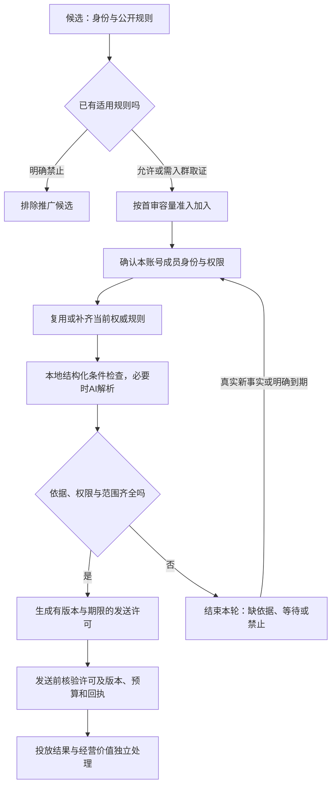

# 推广资格系统 V4 重设计方案

> 本版已撤回，由[审核读取优化 V4](2026-11-03-review-read-optimization-v4.md)替代。用户明确要求保留普通成员广告满24小时的试投路径，包括一般禁广告规则的覆盖关系；新方案仅优化读取。本页收紧准入、短期许可、固定巡检、库存上限和退出策略调整均不作为当前实施要求。

状态：设计提案，未实施、未发布。日期：2026-11-03。

基线：[当前机制完整梳理](../reports/2026-11-03-review-mechanism-explained.md)、[读取额度评估](../reports/2026-11-03-review-budget-assessment.md)。

## 1. 目标与明确取舍

目标是让每一次读取都有明确缺失项，每一个审核任务都有结束状态，每一份发送许可都有可追溯依据。降低重复采集，同时避免通过放宽判定或增加预算来制造吞吐。

V4采用三个对象：**群规则事实、账号成员事实、发送许可**。任务只修复缺少或变化的对象，不再把观察、连接恢复、规则变更、账号身份和广告反馈都送进一次完整审核。

明确取舍：只有适用的群规明确允许、或可核实的管理员许可及其范围，才能授予第三方群推广资格。普通成员广告和自身广告存活，只用于经营价值及投放反馈，不独立产生许可，也不能覆盖明确禁令。初期可投群数可能减少，不能承诺新方案一定提高发送总量。

既有自有群管理/发言通过独立管理模块及其既有权限运行，继续从第三方推广资格流程排除；人工保护和人工暂停继续生效。

## 2. 删除、保留和替换

| 当前机制 | V4处理 |
| --- | --- |
| 近72小时普通聊天作为资格首审常规材料 | 删除默认扫描；采集当前权威规则及所需上下文 |
| 普通成员广告存活24小时放行trial | 移到候选价值信号，不授予许可 |
| 自身广告存活恢复资格 | 保留结果证据，恢复仍需当前许可与权限 |
| 多个observe分支反复定时 | 改为稳定的缺证据状态及明确唤醒条件 |
| 群级规则按账号重复采集/送AI | 群级事实与语义解析复用，账号权限独立 |
| 规则/权限/技术错误混为一个decision | 分开业务结果、事实新鲜度和任务状态 |
| 普通频道更新/gap变完整复审 | 更新差异恢复，必要时局部事实核验 |
| 续采进度5分钟后整包失效 | 按事实依赖失效，稳定材料不随排队超时丢弃 |
| 人数小、48小时没有广告触发退群 | 移到独立经营价值策略，默认归档/停止投放 |
| 删除/禁言反馈与首审混合 | 独立投放反馈流程，先暂停/核实，退出另行决策 |
| 共享PG、账号池、风险退避和回执机制 | 复用，不另建连接池或改动共享服务 |

## 3. 核心数据与权限边界

| 对象 | 关键内容 | 复用边界 |
| --- | --- | --- |
| 群规则事实 `group_policy_fact` | 规范群ID、来源消息/简介/置顶、来源身份、材料摘要、版本、覆盖范围、观察时间 | 同租户、同群、可见性等价的上下文可复用 |
| 群规则结论 `group_policy` | ALLOW / CONDITIONAL / DENY / UNKNOWN；内容、话题、审批和频率条件；证据引用；解析器版本 | 规则材料及解析版本一致时复用 |
| 账号成员事实 `membership_fact` | 账号、群、本次加入代次、角色、发言权限、禁言期限、验证状态、确认时间 | 不跨账号、不跨本次加入关系复用 |
| 发送许可 `send_permit` | 账号/群/加入代次、规则版本、权限版本、资料/模板版本、允许范围、期限及撤销原因 | 只供绑定的具体对象使用 |
| 工作 `qualification_job` | 触发来源、目标事实、依赖版本、已完成步骤、缺失项、截止与重试原因 | 同逻辑目标与依赖版本只有一个待办 |
| 不可变工作事件 `qualification_work_event` | 领取/预留/实际RPC/完成/等待/失效、成本、新增事实、旧新版本 | 计量和追溯，不能被最新审核结果覆盖 |

新表是逻辑设计，实施时优先复用现有事实表、预算账本与outbox，避免建立第二套冲突的授权或扣费来源。私人可见材料不能无条件变为所有账号的共享事实。群事实复用永远不能把账号A的可发权限授予账号B。

同一可见性范围的群采集只选一个当前可用、已在群内的账号执行，并通过现有AccountPool及租约取得连接；其余账号等待共享结果。选中账号不可用时允许有版本栅栏的接替，不重复建立Telegram客户端。

材料摘要不包括观察时间等无关字段；相同内容重复到达不升级规则版本。角色、适用范围或实际内容变化则升级。账号退出再加入生成新的加入代次，旧许可不可直接继承。

## 4. 新流程



### 4.1 候选与加群

候选只检查规范群身份、公开规则、已知经营价值和可加入性，不拉取72小时聊天。人数、在线数、广告活跃只用于价值排序及用户配置的候选标准。

无法在加入前取得规则的群，可以进入受限的取证候选；每账号初始同时最多1个“已加入但首审未完成”的新目标，并建议最多保有5个“已加入但未获许可”的待取证目标。两者分别限制在途工作与实际库存，均为灰度建议起点，不是平台限制。NEEDS_EVIDENCE虽然结束任务，仍占未授权库存；归档也不等于离群，不能靠完成/归档标记释放名额。历史存量同样参与盘点，不能用迁移绕过上限。加入需预留可完成成员确认与首轮规则取证的容量；没有容量先不加入。

等待管理员批准的加入请求只保留一个加入结果任务，不进入资格采集循环。确认加入后只创建该加入代次的首审。

### 4.2 当前权威材料

采集群简介、当前置顶集合及相关正文、已保存的有效管理指令、可核实的管理员明确许可。新指令先核实来源及适用对象，不把普通聊天关键词视作群规则。

不默认做普通发言者身份普查；只核实本账号、必要规则作者和明确许可来源。需要额外上下文时必须记录“缺哪条事实、从哪个来源补取”，一次补证只取该范围。

首轮采集后允许最多一次有目标的业务补证包；预算导致的分片续做不算新的补证。仍缺依据时结束为NEEDS_EVIDENCE，不把未知变成拒绝，也不不断扩大历史扫描。真正新规则或新许可可以开启新版本工作。

### 4.3 规则与AI

规则结论为ALLOW、CONDITIONAL、DENY、UNKNOWN。明确适用的禁令优先；例外必须来自可核实的授权来源并绑定对象、内容、话题和期限，运营人员勾选“通过”不能代替群方许可。

第一阶段继续只支持现有text_profile内容能力，不同时扩展媒体、正文URL或话题路由。群规要求的条件若系统尚不能执行，记录CONDITIONAL及不支持项并停止该范围投放，不能把结构化识别到条件视为已经满足。

确定性规则先处理。只有歧义、例外、条件或冲突需要AI；AI负责提取并解释带引用的结构化条件，不凭“别人发过”“没有看到禁止”制造批准。AI置信分数作为诊断信号，不能替代来源和条件校验。

群级解析键为“群＋权威材料版本＋解析器版本”，不包含账号或观察时间。复杂内容适用性若需AI，另按“规则版本＋资料/模板版本”缓存。相同材料不重复调用；新版本才允许新解析。

模型配置错误或调用失败是系统故障，不产生DENY或退群事实。自动策略最多尝试一次已发出请求；明确未发出的预检失败等待服务健康恢复。结果不确定时保留UNKNOWN，显式重新解析需留原因及新解析版本，不用后台循环重复收费。

## 5. 状态机必须能结束

业务准备状态和工作运行状态分开，页面同时显示两者。

| 业务状态 | 进入条件 | 恢复条件 |
| --- | --- | --- |
| READY 可发送 | 许可依据、账号权限、内容条件和新鲜度全部满足 | 相关变化后退出READY |
| WAIT_UNTIL 等待到期 | 有确切禁言/审批有效期限等 | 对应事件或唯一到期任务；到期仍需确认 |
| NEEDS_EVIDENCE 缺少依据 | 规则不明、证据冲突、当前权限未知或关键事实过期 | 新证据、依赖服务恢复或显式重查 |
| BLOCKED 禁止发送 | 已确认禁令、账号限制或条件不满足 | 已确认的禁令解除或权限恢复 |
| PROTECTED 保护对象 | 自有/管理/人工保护等 | 明确的保护配置变化 |
| CLOSED 关系已结束 | 已离群、被踢或账号关闭等 | 新加入代次重新开始 |

工作状态仅为QUEUED、RUNNING、DEFERRED、SUCCEEDED、FAILED、CANCELLED。任务到期或有限技术重试耗尽后FAILED/DEFERRED并脱离执行队列，依赖健康事件或显式操作再唤醒，不能常驻轮询。

单片上限之外还有限制整个决策周期的累计RPC硬上限，按“必需首轮步骤P90之和＋最多一个补证包P90”生成；冷启动需使用明确的步骤配置，不能默认无限。一个周期最长24小时，连续两片读取没有新增有效事实则结束为NEEDS_EVIDENCE。预算分片、技术续片和服务恢复不重置累计成本或原始截止；来自重复/无实质变化事件的版本也不能重置。真正新事实建立新周期时，历史成本仍计入同群滚动成本和公平调度，不得借新版本逃避总量保护。

NEEDS_EVIDENCE是已完成的一种业务结论，不持续占审核债务，不每2小时重新采集。WAIT_UNTIL只有一个到期唤醒。预算不足不递增业务尝试次数、不删除材料；已发出的RPC失败计入成本。

## 6. 事件只修对应事实

| 事件 | 处理 |
| --- | --- |
| 本账号被禁言、角色/默认权限变化 | 对应许可立即暂停，只刷新本人/默认权限 |
| 已保存规则被编辑/删除、置顶集合变化 | 相关许可标记待核验，只取变化来源及集合摘要 |
| 新疑似管理指令 | 有界核实来源和适用范围；普通聊天不触发完整审核 |
| 账号资料/模板变化 | 重算内容条件，不重采群历史 |
| 普通成员广告、讨论含“广告/禁止”等词 | 更新价值信号，不触发资格全审 |
| 广告删除、禁言或结果未知 | 处理该投放及相关许可，禁止用试发验证许可 |
| 普通重连 | 恢复连接和更新游标，不生成全群规则变化 |
| 更新缺口gap | 先修更新连续性，确认受影响事实后局部核验 |

默认合并窗口60秒，同逻辑目标最多一个待办；运行中来的事件更新目标版本，旧任务只能确认自己处理的版本，不能清除后来事件。明确禁止、权限撤销及关键来源变化的本地阻断立即生效，不等60秒。

持续事件最多延后普通合并执行120秒，不能无限延期。若受限流或预算无法完成则保留暂停，进入有明确原因的等待。单群持续事件也不能重置其累计成本或占满所有账号轮次。

gap先通过Telegram差异恢复重放事实。无法补齐时，对受影响目标读取当前规则来源摘要和本账号权限，核对版本；无法恢复关键覆盖则停在NEEDS_EVIDENCE，不重扫72小时。断流不能无限继承旧事件授权。

## 7. 新鲜度与发送许可

V4保留事件撤销，同时引入可验证的新鲜度边界，避免事件监听漏失时授权永久有效。以下是灰度建议初值，实施前需结合成本校准：

| 参数 | 建议起点 | 含义 |
| --- | --- | --- |
| 活跃目标的本人权限有效期 | 15分钟 | 仅即将发送且事实过期时刷新；事件可提前撤销 |
| 群规则来源摘要检查上限间隔 | 24小时 | 仅活跃目标；一次群级摘要比较，可跨账号复用 |
| 发送许可最长有效期 | 15分钟 | 实际到期取各依赖有效期的最早值；纯本地重新发证不扣读取 |
| 事件合并 | 60秒，普通合并最长120秒 | 明确撤销立即生效 |
| 单次工作片 | 最多8次读取或20秒 | 仅限取证读取/本地步骤；是执行边界而非完整审核成本承诺 |

规则摘要未变不重新解析AI、不取普通历史；这些短期刷新和摘要检查可以产生必要读取，不能承诺“无变化时永远零RPC”。稳定材料有效至来源、可见性或依赖版本变化，排队超过5分钟不丢整个进度。工作片超时策略不适用于盲目重试Telegram发送、验证或退群等写操作；写结果不确定必须沿既有对账规则处理。

发证依赖：群规则版本、账号加入代次、个人权限版本、资料/模板版本、适用范围以及监听覆盖/局部核验有效性。任一关键依赖不满足，就不能READY。许可到期锚定原事实的实际观察时间：取“权限观察时间＋15分钟、规则摘要观察时间＋24小时、群方许可到期及其他依赖期限”的最早值。纯本地重新发证不能把观察时间改成现在；许可自己过期不创建全库存维护任务，只在临近真实发送时刷新需要的事实。

监听确认有未补齐的更新缺口时暂停受影响许可，先恢复或局部验证；普通重连完成追赶后可复用未变化版本。24小时摘要维护不能代替连续性覆盖：只看到旧简介/置顶内容没变，不足以证明缺口期间没有新增未置顶的管理指令。关键规则覆盖无法恢复的目标保持NEEDS_EVIDENCE，需补齐缺失来源或取得当前明确许可，不能仅凭摘要相同恢复发送。

发送前在本地原子核验依赖版本、许可期限、人工暂停、风险、频率、预算及前次回执，取得唯一发送操作记录，然后通过现有AccountPool和账号租约执行。不在网络请求期间持有长数据库事务。外部权限在发送瞬间变化所返回的错误，进入事实更新与投放反馈，不通过自动重发试探。

## 8. 预算与加群背压

第一阶段保留每账号180/分钟、360/小时、3600/24小时的现有总保护，风险系数、FloodWait和平台等待优先。这是系统配置基线，不是Telegram保证的安全阈值。

预算分两层：容量计划只估计剩余工作债务；实际执行按有界步骤原子预留，逐次RPC计费，结束释放未用预留。两者不能重复扣费。Redis继续作为当前实际准入/扣费权威，PG不可变账本记录生命周期并对账，不能建立第二套独立可变余额。

已调用失败仍记消耗；纯本地判定、材料复用、排队和预算等待不扣读取。预留超时不得退回已经发生的调用。成本采用各类已完成步骤的P90，过滤零读取等待，重新采样V4，不能把旧24–26次片成本直接当新流程成本。

不在迁移第一天改写全部通道额度。先让V4计划器服从现有真实用途/借额准入；验证一个完整窗口后，再把静态份额逐步替换为真实到期业务保护量与弹性分配。不同账号余额继续独立。

```text
可接新群数 = min(
  业务日上限剩余,
  可加入目标数,
  初始待首审并发容量,
  已加入未获许可库存剩余容量,
  floor((可用于加入与首审的实际容量 - 已有可推进审核债务 - 其他到期业务保护量)
        / (加入成本 + 首轮确认成本))
)
```

计算需分别检查分钟、小时、24小时约束及对应完成时间范围；负数取0，不把不同时窗简单相加。债务与保护量按同一范围计算，已经在借额准入中保护的量不再重复减。不能让未来日额度支撑当前小时无法完成的加入。

30群/天保留业务上限，不当必须完成的指标。缺证据但已结束的关系不持续占审核债务；真正可推进的旧工作应先完成，再接新群。

调度按“阻断变化的本地处理 → 有近期发送需求的权限修复/新群首审 → 明确到期工作 → 候选探索与低优先级维护”，同优先级在账号与群间公平轮转，并对可推进首审使用等待年龄提升，避免被活跃群长期饿死。每次执行一个有界步骤，不能让单群不断新事件霸占日预算。

## 9. 广告反馈、验证与退出分离

入群验证继续独立，动作后只刷新验证及发言事实，不重新启动整套群历史采集。未知题和不确定动作不盲试。

广告成功、删除、禁言与未知回执保持独立事件：删除先暂停/核实并按经营策略降频；禁言立即暂停对应关系；结果未知继续对账，不能自动重发。自身广告存活是投放结果，不是新许可来源。

资格系统不直接执行自动退群。人数少、在线少、48小时无广告仅影响价值等级及归档建议。退群由独立、明确配置的关系保留策略负责，统一应用保护、人工暂停、目标身份和本次加入代次检查。

V4灰度默认关闭自动退群，仅展示建议与依据。已经离群/被踢直接关闭关系；明确永久限制可进入建议退出，但不从AI失败或技术故障生成退出事实。后续启用自动退出需有单独可审计的策略，不继承旧隐式条件。

## 10. 界面和指标

页面不再用“审核次数”概括所有工作。每个关系显示：业务准备状态、具体缺失项、当前任务、规则依据、适用内容、权限确认时间、下次动作及唯一恢复条件。

展示三个独立计数：规则解析/AI调用、Telegram实际读取、完整业务结论。NEEDS_EVIDENCE、BLOCKED与READY分开统计，不能通过把所有任务标完成美化指标。

每个工作记录触发类型、来源版本、合并数、累计预留/消耗、失败调用、新增和复用材料、推进步骤、等待与解除原因、最终结论。关键指标：

- 首审结论P50/P95时长、加入后目标时间内完成比例；
- 每个READY结论成本及NEEDS_EVIDENCE结论成本，分别统计；
- 同版本重复材料读取率、事件合并率、真正改变授权的事件比例；
- 活跃授权修复时长、可推进首审积压、账号和群公平性；
- 实际成功广告数、可投目标数、额度等待及FloodWait趋势；
- AI实际请求数与同材料复用数、账本与实际RPC对账差异。

首阶段不承诺节省百分比；确定性目标是删除无变化的业务轮询、同规则不重复解析、技术失败不制造禁止事实和所有队列任务有终点。

## 11. 迁移与回滚

1. **建立单独V4开关和不可变计量。** 复用当前账号池、预算和发送回执；确认PG账本接线，不启动旧数据库，不改共享PG、Redis或授权配置。
2. **用已有材料做离线/影子判定。** 不额外发送或退群，不批量新增Telegram采集；区分新旧差异是判定规则变化还是证据缺失。
3. **分类旧记录。** 明确许可且来源、时效和账号条件可核实的旧allowed可生成V4许可；只靠先例的trial、自身存活或来源不足的旧授权进入NEEDS_EVIDENCE，不批量继承。旧reject中的AI配置/故障不得迁移为DENY。
4. **先切一个推广账号。** 顺序为停止旧任务领取、排空已运行发送/退出、对账未决回执、在共享写边界切换所有者epoch、启用V4。仍不确定的发送保持对应目标阻断，不自动重发；新旧发送执行器只能有一个所有者，仅给新任务添加epoch不够。该账号的旧审核、事件续授权、验证与退出业务写入路径一并停用或只读，不能只替换页面。原始Telegram监听、事实入箱和回执对账保持运行；切换前由V4接管事件水位与未处理撤销，核对无缺口后才开放新许可，不能因停旧执行器丢失规则变化。
5. **至少观察一个完整预算窗口。** 同时看明确结论成本、可投目标和真实广告回执；确认新鲜度检查没有反向制造大量读取，再扩大到其余账号。
6. **单独评估预算分配与退出策略。** 验证需求驱动借额后再调整份额；默认不提高总上限，不立即开放V4自动退群。

迁移可能暂时减少可投库存，应优先补齐有真实近期投放需求的明确许可目标，不用继承不成立的旧许可保持表面吞吐。

回滚保留已确认禁令、暂停、权限撤销、未知回执和所有实际扣费；不能把回滚解释为恢复“先例覆盖禁令”或重新发送未知广告。若旧执行器无法尊重这些阻断，则暂停该账号投放，待修复后恢复，不直接回到不兼容的旧写入路径。

## 12. 验收用例

| 场景 | 必须结果 |
| --- | --- |
| 禁广告规则与24小时普通成员广告冲突 | 不授予许可 |
| 只允许指定话题/审批通过账号 | 不能向根话题或未批准账号放行 |
| 四账号加入同群 | 规则事实与解析可共享，四份本人权限独立 |
| 100条普通聊天提到广告/禁止 | 不生成完整资格审核 |
| 同分钟20次相关规则事件 | 单目标待办合并，最终处理最新版本 |
| 旧任务执行中又来新规则 | 旧任务不能确认/清除新版本 |
| 单账号禁言 | 立即暂停该关系，不把其他账号也判禁言 |
| 无相关变化连续24小时 | 无历史重扫或重复AI；只允许设计内的新鲜度维护 |
| AI超时/配置错误 | 不制造DENY、READY或退出事实 |
| 长预算等待后恢复 | 续做原步骤，不丢稳定材料，不重复扣费 |
| 成员退出后重新加入 | 旧许可不可直接复用 |
| 监听出现无法恢复的关键gap | 停止陈旧许可发送，定向核验 |
| 发出成功但回执丢失后重启 | 先对账，禁止盲目重发 |
| 人数少或48小时无广告 | 默认只影响价值与归档建议，不自动退群 |
| 单个热点群持续事件 | 不能占满全部执行轮次或无限重置补证次数 |

实施完成的判定是：许可依据可解释、状态恢复条件明确、调用账本可对账、旧循环写入已退出、单一发送所有者成立，并通过上述边界用例。只降低审核片数不算验收通过。
