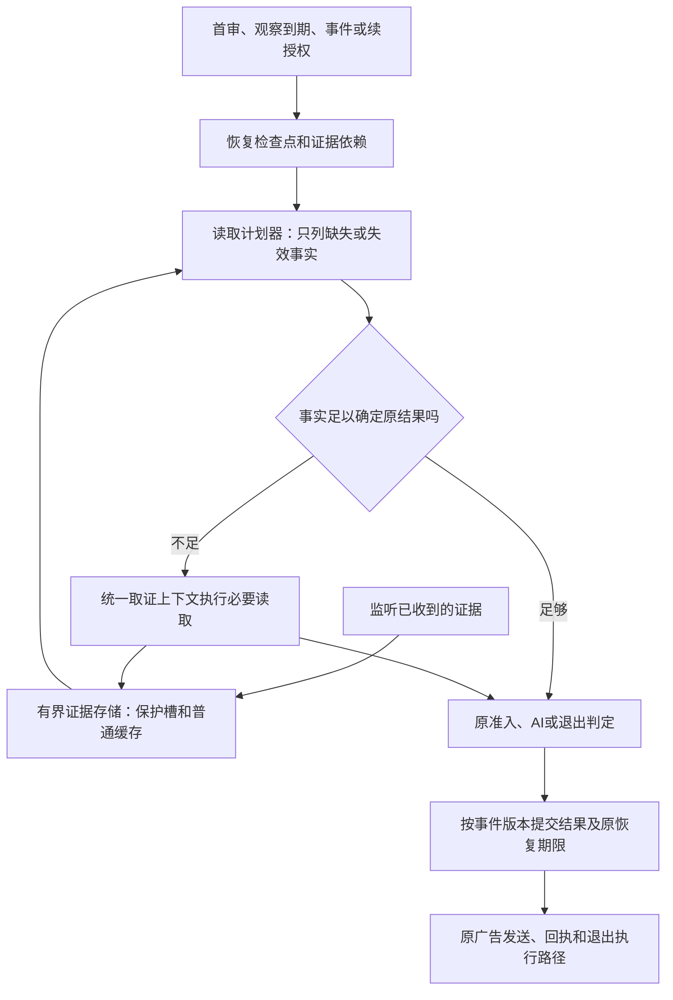

# Vanguard 审核降读完整方案 V5

最新状态（2026-11-04 17:33:28采样）：r8及前端已上线；账号34开启9个优化开关及新证据接纳，其余账号保持baseline。四账号ONLINE、监听与owner均已恢复；审核积压和预算等待仍在。同容器间隔287.203秒的检查证明三角色维护心跳前进，32条原证据完整保留；正式测试包174通过。实际收益仍为`insufficient_evidence`。17:14:42重新切换计量后，首个可能完整24小时窗口最早至11月5日18:00；独立业务来源与coverage尚未接齐，不能只等待时间届满即验收。详见[六项修复与生产复核](../reports/2026-11-04-review-read-v5-six-fixes.md)及文末实施状态。

日期：2026-11-03；状态更新：2026-11-04。历史r3/r5/r6/r7的修复、临时关闭及旧观测时间保留在各轮报告中，不代表当前开关状态。14:20审计发现的旧KeyError具体键/行根因仍未定位；完整公共材料/跨账号等价共享及自然成熟、截止接管生产验证仍有缺口。历史依据见[下午全面审计](../reports/2026-11-04-review-read-v5-afternoon-audit.md)、[运行阻塞修复](../reports/2026-11-04-review-read-v5-runtime-completion.md)、[实际收益验收协议](../reports/2026-11-04-review-read-v5-benefit-validation.md)与[初次实施记录](../reports/2026-11-03-review-read-v5-implementation.md)。

本文为当前统一方案，合并一期优化、二期额外降读、存储硬限和24小时证据保护。之前两份分期文档作为设计依据保留；实施和评审统一使用本文。已撤回的资格重设计不再作为实施依据。

> 后续核查纠正：生产已有 session owner 转发，账号 34 的自然审核确实在 owner 执行。Celery 本地缺少前置条件不能独立解释全部零缓存；不能每任务启动会全槽写 gap 的组件或放宽门禁来伪装修通。r3 已修另两项确定问题，缓存真实原因通过自然业务诊断继续定位。详见[差距复核及归因纠正](../reports/2026-11-04-review-read-v5-gap-check.md)。

## 1. 目标与范围

在保留现有推广准入、退出、账号隔离和读取预算的前提下，减少Telegram实际读请求。采用“先恢复已有证据、只补必要事实、结论确定后停止无关采集”的执行方式。

同时满足三个目标：

1. 一期审核＋续授权读取按下降20%–25%规划，先实测。
2. 二期以一期实测剩余读取为分母，再下降30%作为验收目标；两期累计目标约44%–47.5%。
3. 新增证据存储有时间、字节、记录和物理磁盘上限；已接纳的24小时观察证据不得因容量紧张被提前清理。

本方案改读取计划、证据复用、进度恢复和有界存储。账号代理配置、推广素材、机器人验证业务、广告频率与共享数据库部署不在本次变更中。

## 2. 当前问题与基线

以下复用11月3日11:35–11:38取得的最近24小时工作样本，不代表此刻额度，也不是独立完成审核数。

| 账号 | 审核读取 | 续授权读取 | 合计 |
| --- | ---: | ---: | ---: |
| 2 | 218 | 15 | 233 |
| 33 | 1153 | 770 | 1923 |
| 34 | 1675 | 901 | 2576 |
| 35 | 1237 | 972 | 2209 |
| 合计 | 4283 | 2658 | 6941 |

已确认的成本来源：续片先重读前置材料再恢复游标；进度超时或新事件使整包失效；同次不同采集器重复查消息/身份；无关聊天作者也先查身份；监听收到正文后丢弃、审核再取；观察未成熟时重复采集；初始化和同目标事件重复执行。

35号约80%的审核读取来自观察工作片，这只说明成本集中，不代表80%可以取消。身份读取占比高也不等于身份查询全是重复。

## 3. 固定不变的业务规则

审核对象保持为“账号×规范群身份×本次加入关系×text_profile范围”，并绑定账号资料和政策版本。账号退出重入、资料变化、权限变化必须按原规则重新确认相应依赖。

| 路径或结果 | 本方案保留的行为 |
| --- | --- |
| 普通成员广告先例→trial | 根话题、已核实普通且非系统成员；从发布或最后编辑较晚时刻起满24小时；原帖可访问、警告检查完整且无警告 |
| 一般禁广告群规＋上述合格先例 | 继续按现有先例路径允许trial；其余门禁及退出规则独立生效 |
| 明确许可→allowed | 保留原本地规则、AI材料去重、95分及引用等要求，不因降读改变AI准入 |
| 自身广告存活恢复 | 保留原资格、成功回执及真实满24小时存活等全部条件，旧success日志不能单独放行 |
| observe / wait / technical_wait | 分别表达证据不足、已知限制期限、技术或预算等待；未知不转换为允许或业务拒绝 |
| reject | 不授予本次资格；不能单凭reject直接退群 |
| protected | 自有、人工保护、管理身份等继续排除推广及自动退出 |

原text_profile范围不扩展为媒体或正文URL。现有授权、事件阻断、资料指纹、账号风险、频率、冷却、暖机、配额和未知发送回执门禁继续生效。发送前不新增每条广告重扫历史或调用AI。

保留资格审核的四类独立退出事实：最近48小时完整覆盖且确认无普通成员广告；已核实人数少于50；明确全群禁广告且真实在线少于2；已确认永久或符合原规则的超过3天长期发言限制。未知、隐藏历史或身份缺口不能形成负面证明。

资格退出保留本次约5分钟内的新鲜证据及最终身份/保护检查。自适应广告反馈退出仍走其独立证据路径，不强行套用完整审核的5分钟要求。两类退出开关、作用域和执行前检查不变。

## 4. 总体结构

一个真实取证执行器处理同一逻辑目标和事实版本，首审、续片及续授权消费结果。业务状态分别保存，不相互覆盖。继续使用AccountPool及既有租约，不新建重复客户端。

## 5. 统一证据和进度模型

| 对象 | 必要内容 |
| --- | --- |
| 取证上下文 | 账号/session代次、群、加入代次、任务、事件版本、查询结果、来源与实际RPC |
| 事实记录 | 类型、对象、正文或定位、原始/编辑时间、版本、观察时间、可见性和失效原因 |
| 覆盖记录 | 实际区间、分页状态、读取账号/加入时期、消息水位、角色覆盖、分类器版本与缺口 |
| 步骤检查点 | 输入依赖版本、已完成输出、历史游标、缺失项、下一恢复条件 |
| 候选保护槽 | 具体消息版本、成熟时刻、核验截止、预留字节/记录、控制状态及必要依赖 |

事实状态区分已核实、未执行NOT_EVALUATED、未知/缺口、已失效。未读规则不能保存为空规则或“无禁令”；缓存缺失不能保存成“没有广告”。

依赖变化只使相关步骤失效。取消“超过5分钟整包报废”，但保留本人权限、ordinary现场确认及退出前证据的原新鲜度。缓存到期只影响命中，不主动创建Telegram读取。

提交时核对输入事件版本，旧任务只能确认其实际消费的版本，不能顺便确认执行中后来到达的事件。相关新变化继续阻断原发送路径。

## 6. 一期：先消除可确认的重复读取

1. **同片统一读取。** 实体、本人、full-info、权限、原帖、置顶与角色结果统一引用。同账号同群、相同参数和有效事实最多读取一次；新失效或不同语义的查询单独处理。
2. **先恢复再采集。** 加载有效检查点与游标后补缺项，不先重读三个日期首批历史。窗口前移只补新增区间，缺口单独标记和恢复。
3. **精确失败退避。** 相同已知失败接口不跨函数反复调用，未知保持未知；按原退避恢复，不增加缓存轮询。
4. **候选优先与成熟定点核验。** 有可用先例先查指定原帖及必要依赖；未到成熟时间且无相关变化，不再重抓整包材料。
5. **同目标单飞与事件合并。** 首审、观察、续授权共享有效取证；同事实版本只执行一次公共采集。
6. **有条件共享公共材料。** 先账号内验证，再开放可证明可见性等价的跨账号原始材料复用。

同轮消息ID合并、跨collector角色复用、原帖复用属于统一能力；如果一期已完成，二期不得再次认领同一收益。隐式GetUsers/GetState/GetDifference和失败读取均计实际成本。

## 7. 二期：原结果的充分条件满足后停止采集

充分条件快速路径必须同时满足：

1. 账号、群、本次加入关系及系统身份正确，非保护/自有/管理范围。
2. 本账号真实在群、可发文字，收费、临时限制、账号资料、历史投放及频率/回执等原门禁均满足。
3. 已核实当前人数至少50、真实在线至少2。
4. 一条根话题广告的**原发布时间在最近48小时内**，并且`max(date, edit_date)`已过去至少24小时。
5. 当前账号确认原帖可访问、内容和时间未变，作者ordinary且非系统成员；必要警告检查完整且无警告。
6. 没有足以改变结果的相关未处理变化、未知依赖或技术错误。

该组事实排除了相关退出分支，并按原先例路径支持trial，可以停止无关聊天作者普查、不影响结论的置顶角色解析和三天历史采样。未读群规标记NOT_EVALUATED；以后在线下降、先例失效等使群规影响结果时，先补证。

任一条件不满足，只回到原有必要取证，不新增拒绝。48–72小时前的先例保留原有作用，不强制走这条快速路径。

时间口径必须分开：trial成熟按`max(date, edit_date)+24h`；48小时广告存在证明按原date。原帖60小时前发布、36小时前编辑即使已成熟，也不能证明最近48小时有新发广告。

身份查询先本地筛选与判定有关的消息，再解析必要作者。valid_messages、unknowns、warning_search_complete、历史重入和48小时无广告退出的全部消费者必须审计；负面证明分支继续原完整取证，不能删掉未知项来省调用。

## 8. 监听证据直接消费

在listener_interest和protocol compact两条正文裁剪路径之前，识别并保存必要广告、规则、警告及版本。普通聊天只保分类/覆盖索引；不保存全量正文、不下载媒体文件。

保存消息ID、群、作者、接收账号、date/edit、正文必要字段、回复关系、版本/删除标记、协议及业务持久化水位。原先32槽覆盖和只取6个提示的机制只能作候选提示，不能作为完整覆盖证明。

成功持久化后再确认业务消费；去重基于消息和事件版本，不能用正文相似就丢掉可能有效的管理指令。溢出、缺失、写入失败或无法恢复的更新形成明确缺口。

已收到的相同版本可直接供审核使用，省掉再次GetMessages；成熟时仍现场确认原帖、编辑时间、作者和必要警告。消息流连续不代表角色变更完整；“未收到变化”不能替代必要的新鲜检查。

新管道需预热或有界回填。开启日志不会自动拥有过去72小时材料；预热、同步、淘汰补偿和回填全部计成本。

## 9. 24小时证据保护与存储上限

### 9.1 逻辑容量与物理容量

以下数值为初始配置建议，实施前通过真实序列化大小和磁盘配额验证；不是已生效配置。

| 配置 | 初始建议及约束 |
| --- | --- |
| 全部账号新增证据逻辑总额 | 256 MiB，按UTF-8序列化字节及约定元数据开销核算 |
| 受保护区 | 192 MiB，已用＋尚未落盘的已承诺容量不能超额 |
| 可淘汰区 | 64 MiB，不得借用保护槽已预留空间 |
| 记录总上限 | 100000条；保护区保留50000条，普通区最多50000条 |
| 单个保护槽 | 最多2 MiB、512条记录，含正文、索引、依赖和64 KiB控制区；不足以承诺完整任务则不接纳 |
| 保护槽数量 | 全局最多96槽、每账号最多32槽、每账号每群最多2槽；均为上限，不是预先平均分配 |
| 单账号单群普通缓存 | 同时最多1 MiB、1000条，任一先满即限制普通写入 |
| 单条正文 | 最多16 KiB；超长材料标记不完整并回原取证，不截断后当完整证据 |
| 新增缓存组件物理硬限 | 1 GiB，覆盖载荷、全部新增缓存索引/控制记录、日志、WAL及临时/整理峰值 |

96×2 MiB＝192 MiB，96×512＝49152条，不超过保护记录保留量。槽位按最坏占用预留，不按当前短正文超卖。原帖加最多50条回复，仅16 KiB正文的最坏占用就有816 KiB；还需计身份/规则依赖和索引。依赖超出单槽限额则走原取证，不强行截断。

对每个分区同时满足“实际占用＋剩余已承诺预留≤分区额度”和“实际记录＋剩余已承诺记录≤分区记录额度”。数据从预留转为实占，不重复相加；控制更新、重启恢复、并发写入及整理也必须先有空间。

保护槽的固定控制区优先保存编辑、删除、警告、版本失效及UNKNOWN状态，不被正文挤占。超过可表示依赖时保持未知并补证，不能伪造完整性。

### 9.2 物理硬限的落实范围

所有新增证据缓存正文、索引、控制记录、入箱副本和组件日志统一进入独立、受物理配额限制的存储；不额外复制到共享PG、Redis或无上限死信队列。采用真实文件系统配额或可证明总占用有界的定长布局，应用层计数本身不等于磁盘硬限。

既有账号、任务、授权、回执和审计记录仍由原业务存储管理；锚点复用其当前记录，不再复制完整正文。1 GiB指本新增缓存组件，不是整机数据库或已有业务数据总量。指标及新诊断日志同样有大小限制；不把载荷转储到其他路径或额外备份来绕过上限。缓存可从原流程恢复，不新增无上限备份。

WAL与整理必须预留峰值空间，不能在接近1 GiB时再创建等大临时副本。硬限无法实际落实时，不启用新增持久化载荷，继续原按需读取。不得修改共享PG配置、重建数据库、执行共享库VACUUM FULL或改Redis全局淘汰策略。

### 9.3 保存期限和普通清理

| 材料 | 生命周期 |
| --- | --- |
| 已接纳保护槽 | 按9.4执行；普通TTL、LRU、容量清理及“事件已消费”无权提前删除 |
| 原始业务事件副本 | 受保护事实成功转存后才可删除其副本；其余副本成功处理即删，最长1小时，未处理过期标业务缺口 |
| 普通层候选/规则/警告正文及索引 | 最多72小时，按消息/版本事件时间到期；访问、重试、重放不续期 |
| 当前选中先例锚点 | 原业务记录中保存必要ID、版本、结论与依赖，不长期另存完整正文或无限版本链 |
| 诊断及逐RPC明细日志 | 最长24小时且按大小轮转，不记录凭证和消息正文 |
| 成本与完成量聚合 | 固定维度/时间桶最多7天，用于可比窗口验收；受组件容量限制，不生成无界标签 |

缓存保存期限不修改原授权/证据的业务有效性。生产已有30天证据口径及事件型授权语义与本新增72小时缓存不同，不能把缓存过期当成授权到期。SDK协议恢复日志不受上述1小时副本TTL影响，不推进pts/seq或跳过未处理协议更新。

本地清理每5分钟兜底，不请求Telegram。普通区到自身额度80%先清到期/已消费材料，90%淘汰低价值材料，满额拒绝普通缓存写入。清理覆盖内材料先标缺口；元数据也放不下时，将对应群/账号覆盖整体标未知。已应用警告、编辑和删除事实不能因原事件过期被撤销。

### 9.4 保护槽完整生命周期

1. **申请：** 按账号、群、加入关系和具体内容版本申请，原子预留最坏字节及记录数，成功落盘原帖和必要依赖后才算接纳。
2. **观察：** `t_ready = max(date, edit_date) + 24h`。在该时刻前，保持有效的保护版本不得由TTL、容量或LRU删除。只收到消息不等于确认存活满24小时。
3. **成熟：** 到时进入原预算调度，定点复核可访问性、编辑/内容、作者及必要警告，并补齐其他独立门禁和退出依赖。
4. **结束：** 保存核验结果及最小锚点后释放载荷保护；可在普通层有空间时复用，但不额外复制一份。

为避免成功核验一直受阻造成永久占槽，建议成熟核验宽限初始6小时：`t_deadline = max(admitted_at, t_ready) + 6h`，其值必在满24小时之后。同版本重试不能顺延。截止仍无法取证时，先保存UNKNOWN/待补证及最小定位，转原技术恢复，再释放载荷。该截止只结束本次缓存优化任务，不表示原业务拒绝、无警告、无广告或允许推广，也不缩短原业务取证窗口。

真实编辑先落账旧版本失效，旧版本可结束观察；新版本重新申请空间并从新的`max(date, edit_date)`计算24小时。真实删除或原规则确认不再适用可以结束保护，磁盘紧张不能被解释为候选失效。

观察期间新警告、删除、编辑及gap优先写预留控制区。新正文放不下时必须标依赖不完整/结论失效，按原流程补证；不能因为满额丢掉控制事实后继续trial。只保留当前必要状态，不能无限追加版本链。

保护区满时，已有保护承诺继续履行，停止接纳新缓存观察任务；新候选继续原审核流程。**这是缓存容量控制，不是新的群资格或业务准入门槛。** 成熟前仍有效保护槽被普通清理删除的数量必须为0。

重启必须恢复保护及预留账本，不能将保护槽当孤儿清掉。真实存储故障造成不可恢复缺失时，标技术缺口、阻断受影响依据并补证；不能把故障降级当成正常提前清理策略。

## 10. 跨账号共享、身份与警告边界

原始正文、公共群信息和候选可以在同租户、规范群一致且可见性/覆盖可证明等价时共享；各账号的access_hash、session、本人身份、权限、加入时期、可访问性和AI账号资料上下文保持隔离。

A可见原帖不能证明B可见；B的一次目标消息验证也不能证明其警告或48小时历史完整。角色覆盖与消息覆盖分别证明；不能因消息流无缺口就长期缓存ordinary。

普通作者的现场membership证明按原要求保留。完整管理员名单可以支持原允许范围的规则作者判断；缺席名单不能证明作者仍是普通成员，名单不完整时更不能做负面推断。

| 失败 | 退避键与处理 |
| --- | --- |
| ChatAdminRequired | 查询账号＋群＋接口/能力版本；保留unknown，不能推导作者ordinary |
| UserNotParticipant | 查询账号＋群＋具体作者/对象＋可见性；不扩大为全群接口不可用 |
| ChannelPrivate等 | 账号＋群访问上下文；不能推导群不存在或其他账号都不可访问 |

同次刚取得的原帖可传给警告核验，避免重取root。明确且新鲜的回复数0、同事实快照无变化时可认定该回复集合为空；None不等于0，其他警告范围仍保留。有回复时保留原最多50、实际数量与声明数量一致及完整性要求，匹配警告不缩窄为“仅管理员回复”。

## 11. 不同事件的最小读取计划

| 触发 | 读取/恢复范围 |
| --- | --- |
| 确认加入、缺少首审 | 先候选与已有材料，缺失时按原采样范围完成必要首审 |
| 仅等AI或预算 | 有效材料复用，不重新采集；恢复依原retry_after与整片需求 |
| 未成熟观察且无相关变化 | 本地等待实际成熟/原必要恢复时间，不重抓整包 |
| 本人权限/成员变化 | 刷新本人及必要默认权限，立即沿用原阻断语义 |
| 原帖编辑/删除、作者变化 | 只更新相应版本、角色及依赖 |
| 关联警告或指定规则消息 | 批取缺失ID、来源身份和必要上下文 |
| 简介/置顶变化 | 更新对应规则集合；未影响的历史页保留 |
| 普通重连 | 恢复现有连接及更新进度，不触发全群重采 |
| 真实gap | 先补更新；无法恢复的事实定点/分段补证 |
| 需证明48小时无广告退出 | 完成原覆盖及身份/可访问性检查，不套用正向早停 |

普通候选事件可按60秒短窗合并，但立即登记待处理版本；权限、警告等影响发送的变化不等待合并才阻断。事件语义覆盖保持，不能简单过滤“禁止、广告”等文本来减少触发。

同群同上下文的消息ID真正合并为更少RPC才计收益。NotModified、压缩字节、同一容器打包多个RPC不等于减少调用。回填只为当前必要任务，容量满时可同次内存消费，不把刚淘汰材料立即重新写满或触发全量回扫。

## 12. 读取预算与界面展示

保留每账号180/分钟、360/小时、3600/24小时、当前风险系数、现有空闲借额和FloodWait退避。这是系统运行限制，不是Telegram保证的安全阈值。

基础份额广告35%、留存15%、加群/审核共享25%、同步20%、弹性5%。critical_join与critical_review不是两个独立900日池；完整准入使用需求预测、purpose预算及本次工作所需量，不因零散剩余读取就启动不可完成工作片。账号之间不直接转移预算。

优化后的最小读取计划输入原预算预测，实际RPC才扣实际消耗；预留不是已用额度。缓存槽位配额与Telegram读取预算是两套不同资源账本。

界面将首审、采集续片、成熟等待、事件复验、AI等待、预算等待和存储降级分开显示。显示实际可用读取、工作片所需量、retry_after、证据缺口、保护槽占用和成熟时刻；waiting_ai不显示为审核未通过，缓存满不显示为群不合格。

## 13. 收益目标与核算

| 阶段 | 审核＋续授权样本读取 | 说明 |
| --- | ---: | --- |
| 原基线 | 6941 | 四账号历史样本 |
| 一期中位估算 | 5402 | 预计净省1539，约22.2%，未实测 |
| 二期目标 | 约3781 | 对一期剩余再净省约1621，约30% |
| 两期累计 | 约下降45.5% | 不能将两阶段百分比相加 |

| 互斥调用池 | 原样本 | 一期估计节省 | 一期估计剩余 | 二期额外净省目标 |
| --- | ---: | ---: | ---: | ---: |
| GetState/GetDifference | 562 | 281 | 281 | 0 |
| 身份/参与者 | 2561 | 489 | 2072 | 600 |
| 历史/搜索/原帖/回复 | 2215 | 534 | 1681 | 800 |
| Resolve/FullInfo/GetUsers | 1601 | 235 | 1366 | 221 |
| 其他 | 2 | 0 | 2 | 0 |
| 合计 | 6941 | 1539 | 5402 | 1621 |

这是待证明的任务分解，不是已找到1621次重复。二期不给初始化/同步池再次分配收益；读取集合等一期能力只在其真实启用阶段计一次。每个避免的请求只有一个归因ID，早停、推送和去重不能重复认领。

净节省＝原等价工作量必要执行轨迹与优化轨迹的调用差额，包含新增失效确认、预热、回填、失败及维护成本。公共采集换账号、GetDifference换通道不算消失。

若候选可省调用只有80%能转为净收益，至少需要识别约2027次候选机会，再抵扣新增补偿。找不到足够机会或有界工作集装不下时，下调可实现收益，不能突破硬限、提前删除保护证据或少完成审核来达标。

最终二期分母用一期真实稳定基线替代5402。6941和45.5%仅适用于上述审核＋续授权样本，不能直接称为全系统总读取降幅；全通道另行确认净减少且无成本转移。

## 14. 实施顺序与回滚

| 步骤 | 交付与放行条件 |
| --- | --- |
| 1. 基线与等价用例 | 补逐RPC用途/版本/消费者归因，明确原判定及动态依赖；不改准入 |
| 2. 同片统一读取 | 消除可复现重复、共用账号池和精确失败退避；按开关单独验收 |
| 3. 依赖化恢复 | 先恢复检查点/游标，变化只失效相关步骤，动态新鲜度满足原要求 |
| 4. 候选及定点成熟 | 账号内单飞、成熟时只补必要依赖，保护槽先落实再持久化接纳 |
| 5. 冻结一期实测 | 一个账号灰度后扩大，固定同等业务量、复杂度和真实剩余读取 |
| 6. 推送证据与预热 | 两条裁剪前接入，验证水位、覆盖、保护/普通配额、物理硬限及恢复 |
| 7. 快路径与按需身份 | 证明未读字段不可能翻转结果；无法证明的分支继续原取证 |
| 8. 受限跨账号共享 | 仅开放已验证等价原始材料，个人权限和必要现场核验不共享 |
| 9. 稳定验收 | 二期至少三个完整可比较预算窗口，区分预热和稳定期 |

执行中保持单一实际取证所有者、原发送及退出执行器。影子读取计划只消费已捕获材料，不另发一套Telegram请求作对照。切换时处理在途任务，旧任务不能确认新版本事件。

原allowed/trial及先例依据不因迁移批量撤销，不新增管理员许可要求、15分钟许可TTL或每天全库存巡检。回滚只关闭具体优化并转原采集；保留新事件、回执、失效事实和实际消耗，不重发未知广告或恢复已撤销授权。

保护槽必须支持原流程接管后再结束生命周期，关闭优化开关不能直接清空尚未成熟的槽。所有生产部署仍按oracle4c24g与规范项目Compose执行，不停共享PG、Redis或其他业务。具体执行与结果见实施记录。

## 15. 验收标准

### 业务与时间

- 一般禁广告＋合格普通成员先例仍trial；23小时59分不提前，编辑后重新计时。
- 60小时发布/36小时编辑不算最近48小时新发广告；48–72小时先例仍可走原必要路径。
- 快路径在线/人数条件不满足不直接拒绝；NOT_EVALUATED在规则重新相关时补证。
- 身份变化、重入、系统账号、保护、收费、内容范围和未知回执与原判定一致。
- A可见B不可见、警告/角色/历史覆盖不等价时不误共享；48小时负面证明不缺项。
- 同事实输入下allowed/trial/observe/reject和退出理由等价；资格退出与反馈退出分别验证。

### 存储与恢复

- 任意TTL、LRU、容量及普通清理，在23小时59分不能删除有效保护槽。
- 保护区、普通区、10万记录及1 GiB实际文件总占用均不超限；普通层不能耗尽保护记录或控制空间。
- 并发接纳、重启、消费者停滞、清理失败、超长正文、编辑重计和磁盘整理峰值均有界。
- 保护区满只影响新缓存接纳；已有保护继续履约；新警告/删除仍可先使结论失效。
- 成熟核验超时明确UNKNOWN并移交原恢复，不制造推广许可、无警告或业务拒绝。
- 清理造成的缺口不保留伪完整标记；不撤销已应用事实，不触发反复全群重拉。

### 成本与业务量

- 无相关事件和原定必要工作时不新增审核RPC；等AI/预算且材料有效时不重复取证。
- 同上下文同有效事实重复RPC被消除；一条成熟候选不自动重扫72小时。
- 二期审核相关读取目标≤一期实测的70%；全通道净减少，无账号或通道转移。
- 同等复杂度和业务工作量下，完成量、必要事实新鲜度和处理时长不下降；同时观察trial/allowed、广告成功回执、积压及限流。
- 观察至少三个可比完整窗口，收益逐项归因；容量不足后的原流程和回填成本全部计入。

## 16. 实施前必须完成的工程核对

将本稿的初始配置落实为可测开关与配额；验证2 MiB/512条最坏证据包是否容纳目标分支，不能承诺的任务回原路径。根据实际保护槽需求评估命中率，禁止靠超卖槽位实现30%。

审计valid_messages、unknowns、warning_search_complete、历史重入、AI材料及续授权对未执行字段的消费；核对原ordinary和退出新鲜度。验证角色事件可见范围及两条正文裁剪入口，不能把本地尚未发布实现当作线上已具备。

最终交付应包含：读取计划/证据与配额实现、必要模型迁移、等价与故障恢复测试、阶段开关、运维指标、实测收益报告和回滚步骤。数据库模型确需修改时按现有Alembic流程审查迁移，不在本稿整理阶段执行。

## 17. 依据

- [当前生产审核机制梳理](../reports/2026-11-03-review-mechanism-explained.md)
- [读取预算合理性评估](../reports/2026-11-03-review-budget-assessment.md)
- [一期设计与情景估算](2026-11-03-review-read-optimization-v4.md)
- [二期结构优化与保护槽设计](2026-11-03-review-read-optimization-phase2.md)

本文保留完整设计与验收口径。后续实际代码、发布状态及验证以[实施记录](../reports/2026-11-03-review-read-v5-implementation.md)为准；预估收益不能替代实测。

## 18. 实施状态（2026年11月4日17:33:28采样）

r8及前端已上线，账号34独立灰度9个优化开关及新证据接纳，其余账号baseline。维护失败5秒重试、成功240秒周期已通过真实同容器287.203秒观察：三个角色的心跳均前进，容器ID不变。原32证据全部保留，28份exact、4份仅追加合法同作用域rule，原records/metadata前缀和稳定字段未改。正式测试包174通过。

计量边界为11月4日17:14:42（北京时间），`business_transition_v2`保留历史计数；首个可能完整24小时窗口为11月4日18:00至11月5日18:00。收益工具当前返回`insufficient_evidence`，合格对照0/3；一期20%–25%、二期额外30%、累计44%–47.5%仍是待验目标。

最终采样确认2、33、34、35全部ONLINE、监听已连接且owner存在。33经单次受控connect恢复，34、35在原预算重试到期后自然恢复；跟进中33自然广告成功1次，加群新增完成0。执行器无过期/失联调用候选，但审核业务积压与预算等待仍在。

剩余工程及验收缺口：旧KeyError的具体键/行根因未定位；完整公共材料/跨账号等价共享尚未完成，目前仅局部候选ID共享。collector的healthy、arrivals、backlog起终点、p95等独立来源尚未接齐，执行进程/读通道coverage没有完整证明。validator仅覆盖`same_account_all_governed_sdk_entries`，不能证明全矩阵无跨账号成本转移；须补齐这些来源，不能仅等待24小时。

保护槽自然成熟核验和截止UNKNOWN接管仍待实际时间边界验证。最早成熟11月4日20:44:03、最早deadline为11月5日02:44:03；当前保留证明不能替代这些未来路径的结果。

18:19后的[晚间复核](../reports/2026-11-04-review-read-v5-evening-recheck.md)新增确认监听事件恢复控制、stale claim收尾和普通缓存压力计数问题，并纠正旧due统计的时区口径。17–18点记录917次SDK进入，实际净降幅仍未知；34号低读尚无实际复用/完整业务完成量支撑，方案未全部交付验收。

20:01:34，晚间新增缺陷的 [r9 修复](../reports/2026-11-04-review-read-v5-r9-repair.md)已上线：统一新事件有界恢复入口，预算前本地收尾，错误作用域材料明确转重采，过期清理同步普通缓存计数。冻结45模块组合348项通过，实际工作树243项通过；扩大恢复集仍保留1个旧r8同样失败的父群状态用例，不称全绿。135项线上代码SHA及32份原保护前缀核验通过，只有三应用镜像变化。

r9保留原17:14:42计量语义fence及全部历史计数，另以只读头记录20:02:35代码版本边界。20点小时横跨两个代码版本；r9首个完整代码小时从21:00开始，首份完整24小时读数最早为11月5日21:00，仍须完整性、业务量及对照条件同时满足。此次修复不等于额外减少30%或整体方案已验收，独立来源/全矩阵coverage/公共材料共享及自然成熟闭环等缺口继续保留。

20:12:44最终复核四账号数据库均ONLINE、监听及owner已恢复；35通过既有API单次身份核验恢复，未清预算。r9自然广告成功1次，加群新增成功0次；三个维护心跳均继续推进，32原保护证据完整、270条合法追加。上述运行证据仍不替代降读对照。
