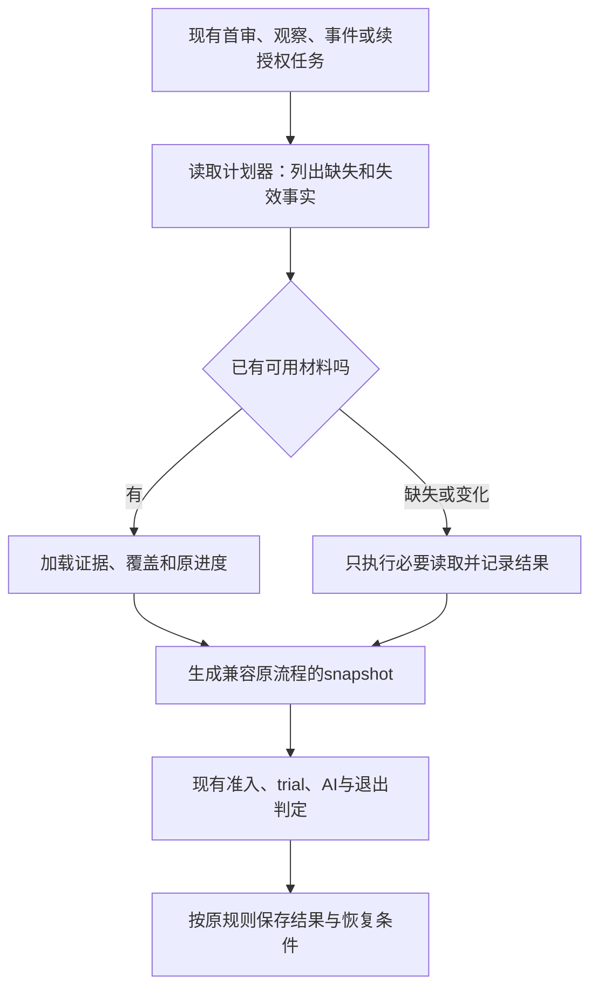

# 审核读取优化 V4：保留原准入，只减少重复读取

状态：修订设计，未实施、未发布。日期：2026-11-03。

本分期设计已合并到[完整方案 V5](2026-11-03-review-read-optimization-complete.md)。统一业务边界、存储配额、保护槽及实施验收以完整方案为准，本文保留作一期设计与估算依据。

本方案替代[上一版资格重设计](2026-11-03-qualification-redesign-v4.md)。用户已明确：**普通成员广告保留满24小时可试投的机制必须保留，新方案的目标是降低Telegram读操作。**

## 1. 固定业务规则，替换取证执行层

保留当前业务判定函数及优先级，先只替换它前面的读取计划器、取证上下文、缓存和进度管理。读取层组装与现有接口兼容的证据snapshot，交给原判定流程。

必须保留：

- 正确群/话题、已核实普通且非系统成员的广告，从发布或最后编辑起保留满24小时，仍可访问，警告核验满足现有要求时，可以trial。
- 上述先例继续可以覆盖一般禁广告群规；权限、身份、收费消息、内容范围、保护和退出事实仍按原规则生效。
- 明确许可路径、自身广告存活连续授权路径、AI材料去重、原有观察/未知/技术失败处理语义。
- 现有自动退出条件及执行前新鲜度检查；不借优化修改人数、48小时无广告或广告反馈规则。
- 180/分钟、360/小时、3600/24小时现有总额度及风险系数、借额、账号隔离和平台退避；加群/广告上限与频率不变。
- 当前事件授权及发送边界；不新增15分钟许可到期、固定权限刷新、每天全库存规则巡检。

本轮不把AI解析次数下降算成Telegram读取节省，也不跨账号直接复用包含账号资料上下文的AI判定。先共享原始材料，完整业务结果仍按原账号及规则生成。

## 2. 成本基线及真正要消除的部分

11月3日11:35–11:38采样中，35号最近24小时审核60片、1237次读取，续授权107片、972次读取，合计2209次。约80%的审核读取出现在观察结果工作片，但观察不等于浪费；不能直接声称这80%都能省。

主要优化对象：

1. 同一片或同一事件中，多个函数重复获取实体、本人、full-info、权限和置顶。
2. 续片先重读各日首批历史，再恢复旧游标。
3. 进度超出5分钟或事件增加一个消息ID后，整包已完成工作失效。
4. 同一作者、同一查询失败，在不同采集阶段重复调用。
5. 同群多个账号重复读取相同消息、群规和历史页。
6. 未到成熟时间的观察重复抓取整片材料，以及成熟时仍重扫历史。
7. 多个事件分别触发近似相同的续授权，以及客户端重复初始化。

`GetParticipant`占比只能说明身份核验成本高；每一项节省都要用参数、版本和实际调用明细证明。

## 3. 四个组成部分



### 3.1 统一取证上下文

同一工作片内，实体定位、本人身份、full-info及各类查询结果进入统一上下文。采集、质量判断、续授权和退出判断引用同一份合格响应，不能各函数再取一次相同事实。

本人ID绑定账号session代次复用；连续工作继续使用AccountPool及现有租约，不另建客户端。实体寻址可复用，但不是当前权限证明。所有隐式初始化读取，包括GetUsers/GetState/GetDifference，计入真实成本。

### 3.2 证据库

持久化已读原始材料、消息索引、作者事实、历史覆盖、依赖版本与读取来源。Redis可以保存指针/短期热缓存，不能仅因热缓存到期而删除业务进度或创建读取任务。

### 3.3 读取计划器

输入为当前任务、原授权/证据、事件版本和覆盖水位；输出为所需事实、已有可复用事实、必须刷新项、最小调用计划及成本估计。若只是等待AI或预算，且已有材料仍可用，Telegram读取为0。

### 3.4 依赖化检查点

保存每个步骤的输入版本、输出、成功调用、原始时间、历史游标、覆盖区间和待办。恢复时先加载检查点，再决定读什么。新事件只使受影响的步骤失效；旧任务不能确认执行中后来到达的新事件。

## 4. 共享与隔离边界

| 可复用的原始群材料 | 必须按账号隔离 |
| --- | --- |
| 消息ID、正文、发布/编辑时间、作者ID及关联关系 | Telegram实体、access_hash及session缓存 |
| 简介、置顶集合、规则与警告材料 | 是否加入、个人禁言/慢速、本人角色与发言权限 |
| 广告候选及成熟时刻 | 本次加入代次、验证状态、资料与原授权 |
| 有来源及版本的作者角色事实 | 本账号能否访问原帖、历史可见范围和接口查询能力 |
| 带观察时间的群人数、在线等公共字段 | full-info中涉及当前查询账号的个人字段 |

共享前提是同租户、规范群身份一致、可见性及覆盖语义可证明等价。不能共享整个Telethon实体或未经拆分的full-info响应。

A能看到广告不代表B也能看到。不同加入时期、隐藏历史、受限成员和特权账号材料不能直接外借。无法证明可见性等价时，B仍做最小目标消息可访问性验证；该验证只能证明对应原帖，不能顺带继承A的警告检查完整性、规则覆盖或48小时历史完整证明，这些范围分别确认或按原要求补读。省掉的是已证明等价的重复历史回填和重复解释，不是B的必要核验。

同一可见性范围的公共材料由一个已有可用账号采集，其他消费者等待同版本结果。没有合适共享上下文时按账号读取，不强行复用。

## 5. 首审：已有先例优先定点验证，冷启动保留必要采集

每群维护候选索引：消息ID、作者、话题、内容及编辑指纹、最后观察、警告覆盖、角色依据、成熟时刻和来源版本。

首审顺序：

1. 查同群已有证据包及候选索引，不先发起三天历史扫描。
2. 选最有希望满足原trial条件的候选，由当前账号确认所需可访问性、内容和时间。
3. 补本人权限、失效作者身份、警告及原规则仍要求的群信息。
4. 当原判定所需事实已经足够，且不存在可能改变结论的未完成退出/限制检查时，交原判定流程结束本片。
5. 没有合格候选或覆盖不足时，执行原有必要的分段采样/补证，保存结果供后续复用；不承诺所有新群首审零历史读取。

原采样范围、消息上限和证据完整性不能借优化任意缩减。原发布时间在最近48小时且满足全部先例条件时，可以证明“48小时完全无普通成员广告”为假；原发布时间只在48–72小时前则不能省掉可能影响原退出判断的48小时覆盖。两个时间口径分开：trial成熟按发布时间与最后编辑时间的较晚值，48小时广告计数按原消息发布时间。原帖60小时前发布、36小时前编辑即使已成熟，也不能当作最近48小时新发布广告。

## 6. 24小时成熟：一个候选一个时刻，到期定点复查

按`max(发布时间,最后编辑时间)+24小时`记录成熟期限，以“群＋消息ID＋内容/编辑版本”为键合并成熟工作。同一先例被多个账号引用时，公共材料不重复回填；各账号仍独立满足可见性及自身权限要求。

成熟前的已有观察唤醒先做本地计划：未出现相关新消息、权限期限或缺失事实时，不重抓整套材料。有完整更新覆盖时，新候选、警告和编辑可由事实入箱推进；没有覆盖不能假定无变化。

成熟时只取：候选原帖、必要的作者角色、该帖相关警告/回复和本账号缺失的权限事实。同时检查群规、人数/在线及原退出依赖是否仍满足原有效性要求，失效部分定向补查；候选成熟不代表完整判定所需事实已经齐全。正文未变、身份及警告覆盖有效且其他必需依赖齐全时不重扫72小时。

编辑使原内容版本失效并重新计算成熟时刻；删除取消该候选的成熟工作；新增警告按现有规则处理。24小时内新发过广告不等于保留满24小时。

## 7. 身份读取：先去重，再按事实与能力分别缓存

### 正向事实

- 同工作片相同群、相同作者、相同有效事实只查一次。
- 跨工作复用需有来源、观察时间、相关角色版本和连续性覆盖；角色升降、成员变化和无法补齐gap使受影响事实失效。消息游标连续不等于成员/角色事件完整，普通账号未必能接收所有角色变化；无法证明该范围覆盖时，ordinary现场确认仍按原流程查询，不能仅凭没有消息gap跨片复用。
- 原流程明确要求新鲜现场身份确认的步骤仍执行必要查询，不靠任意延长TTL跳过。
- 完整管理员名单仅用于已有允许的规则作者判断，不能仅凭“不在管理员名单”证明该作者仍是普通成员。

### 失败与能力退避

| 错误 | 缓存范围 | 不能推导的结论 |
| --- | --- | --- |
| ChatAdminRequired | 查询账号＋群＋接口/能力版本，使用现有退避 | 作者是普通成员、所有账号都无权限 |
| UserNotParticipant | 查询账号＋群＋具体作者/对象＋可见性 | 全群接口不可用、作者属于普通成员 |
| ChannelPrivate等 | 账号＋群访问上下文 | 群已不存在、其他账号也不可访问 |

退避期内，不同函数不再对同一已知失败接口反复碰撞。相关权限恢复、加入/访问变化或原退避到期后，由已有任务尝试必要查询，不新增缓存轮询。失败始终保持unknown，不能生成trial或“无广告”的负面事实。

## 8. 续授权：按事件差异执行，避免整包重做

| 事件 | 最小读取计划 |
| --- | --- |
| 只变本人权限/成员关系 | 只查本人及必要群默认权限，不取三天历史 |
| 原帖编辑/删除 | 定点重验该帖及其依赖，其他消息保留 |
| 作者角色变化 | 只刷新该作者，重算依赖他的先例 |
| 原帖关联警告 | 只补相关警告及缺失上下文 |
| 简介/置顶变化 | 更新相应规则字段和集合，保留无关历史页 |
| 指定疑似规则消息 | 批取指定ID及必要来源身份，再运行原规则判断 |
| 账号资料变化 | 执行原有适用性规则，不无条件清空群历史 |
| 普通重连 | 只恢复连接/更新进度，不生成全群重采 |
| 真实gap | 先补更新，无法恢复的事实再定点或分段补证 |

保留现有possible_rule与警告候选的业务覆盖；先用消息/来源索引和内容版本分流，不能为了降低事件数直接丢弃可能有效的管理指令。只有证明与已处理材料相同或与本次判定无关，才可本地结束。

同逻辑目标及事实版本只有一个取证任务；首审、观察和广告续授权可以消费同一有效证据包，不能相互覆盖业务状态。普通候选事件建议合并60秒，期间立即记录待处理版本；现有发送阻断语义保持。权限变化不因合并而延迟阻断。

批量合并同群原帖、规则及事件消息ID，角色按唯一作者去重。请求参数/可见性不兼容时分别执行，不能为了凑一次API调用丢掉过滤条件、分页或回复范围。

## 9. 历史窗口和长等待恢复

保存读完的区间及分页游标，恢复先使用原游标，不先重读三个日期的首批历史。窗口前移时只补新进入部分，移除已过期部分；消息编辑、删除、警告和角色变化由版本索引更新。

检查点取消5分钟整包报废。稳定正文和已读页面保留；本人权限等动态事实按原新鲜度要求补查，保存进度不意味着继续使用陈旧权限。

覆盖证明必须保留读取账号、加入时期、历史可见性、实际区间、完整分页及更新水位。断流后未补齐的区间不能继续标完整；缓存“没有记录”不能变成“48小时没有广告”。原退出前5分钟新鲜证据和最终身份检查继续满足。

材料缓存TTL仅决定下次已有任务能否命中，不触发主动读取。缓存丢失时恢复缺项，不自动扩散成全账号、全群审核。

## 10. 预算不调大，计量所有实际调用

预算、借额和现有加群准入保持。优化后的步骤成本输入原预算预测，不建立一套新配额或新加群库存上限。

每个实际RPC关联账号、群、工作、触发来源、参数摘要、事实版本、阶段、是否成功和消耗。实际发送的失败读取也记账；纯本地等待不扣费；预留不是已用额度，不重复扣费。

```text
净节省 = 避免的已确认重复RPC - 新增的失效确认/补偿RPC
总读取 = 首审 + 观察续采 + 续授权 + 初始化 + 失效补证 + 必要维护
```

公共采集换到另一个账号后，必须计入所有受影响账号的总量，不能把转移读取当作节省。API调用次数、返回消息条数及读取字节量分别记录，避免通过一次返回超大页面美化成本。

每项优化单独开关，先测同片重复、失败重试和进度丢失，再评估跨任务、跨账号复用。无实测依据时不承诺具体下降比例。

## 11. 实施顺序与迁移

1. **记录实际调用与依赖。** 先补工作账本和调用归因，建立同条件基线；不改准入或现有授权。
2. **同片响应复用、账号池复用、精确失败退避。** 风险较低且可直接确认少发哪些调用。
3. **先加载进度、再补缺项。** 替换5分钟整包报废和先读首批再套游标流程；保留原动态新鲜度要求。
4. **候选索引、单点成熟复查和同事件单飞。** 原判定函数消费新证据，逐项对照。
5. **跨任务、跨账号公共材料复用。** 在可见性边界可验证后开放；边界不清晰则退回账号独立读取。
6. **一个账号灰度后扩大。** 同等事件/证据回放验证业务结果，再观察至少一个完整预算窗口的真实成本和业务完成量。

旧allowed/trial及其先例依据继续保留，不因新方案切换批量撤销、不要求重新获取管理员许可。无需迁移成15分钟短期许可，也不更改原退出开关。

原始监听、事实入箱、回执对账持续运行。涉及取证任务所有者切换时，停止旧领取、处理在途任务、切换版本后启用新版，避免两套采集器重复执行；发送和退出仍由唯一现有业务执行路径负责。

回滚只关闭对应读取优化，保留新事件、实际消耗和回执事实，退回原采集器；不得因回滚自动重发不确定广告或复活已撤销授权。共享PG、Redis和其他业务服务不在本次变更范围。

## 12. 验收标准

### 业务等价是前提

- 一般禁广告＋合格普通成员广告保留满24小时：仍可trial；其他门禁与退出条件仍有效。
- 23小时59分不能提前通过；编辑后按最后编辑时间重算。
- 删除、作者变管理员/系统身份、警告新增、话题不匹配：与原判定一致。
- A可见B不可见：B不能借A的材料取得可访问性证明。
- 重新加入、真实gap、权限变化：不能复用失效的个人事实。
- 48小时无广告和原其他退出条件：覆盖及新鲜度要求不放宽。
- 同一完整事实输入下，allowed/trial/observe/reject及退出理由与原规则一致；增量轨迹另测编辑、删除和并发新事件。

### 读取优化必须有证据

| 场景 | 验收目标 |
| --- | --- |
| 已授权、无相关事件、无原定必要工作 | 审核新增RPC为0，不新增周期巡检 |
| 等AI/预算且已有材料有效 | 不重复采集Telegram材料 |
| 单纯正常重连 | 不触发全群规则/历史复采 |
| 同片相同参数及有效事实 | 实际调用最多一次 |
| 同目标同事件版本多个消费者 | 公共取证单飞，后续消费已有结果 |
| 一条候选广告成熟 | 定点原帖及必要缺项读取，不自动重扫72小时 |
| 只改变一个账号的权限 | 不读取其他账号权限或无关历史 |
| 预算长等待后续做 | 已完成且仍有效的步骤不重做 |
| 精确能力失败退避 | 退避内不重复调用同一必失败接口，结果仍unknown |
| 不同账号共同取证 | 总量计入所有读取账号，必要可访问性确认单列 |

最终同时比较：每个相同复杂度结论的实际RPC、同版本重复调用、首审/续授权完成时长、trial/allowed完成数量、真实广告成功回执及限流情况。不能通过少完成审核、隐藏积压或减少必要验证来取得读取下降。

附：本方案是设计产物；未修改业务代码、生产额度、现有试投授权或退出配置。

## 13. 预计读取降幅与估算假设

以下为设计阶段情景测算，尚无上线实测节省。合理规划取审核＋续授权读取下降20%–25%，保守约10%，条件充分时约30%–40%。不承诺50%以上，也不把观察结果的80%成本视为都可节省。

基线为此前保留的最近24小时工作样本。四账号审核＋续授权共6941次：2号233、33号1923、34号2576、35号2209。样本窗口不等同于当前Redis计费窗口，不能直接从当前used扣除这些估算。

为避免重复计入节省，将33/34/35的实际方法分成互斥调用池：

| 调用池 | 33号 | 34号 | 35号 |
| --- | ---: | ---: | ---: |
| GetState/GetDifference | 260 | 0 | 302 |
| GetParticipant/GetParticipants | 589 | 1102 | 753 |
| 历史、搜索、原帖、回复 | 598 | 928 | 609 |
| Resolve、FullInfo、GetUsers | 476 | 544 | 545 |
| 其他 | 0 | 2 | 0 |

方法属于某一池只表示潜在优化位置，不证明重复。各情景假设以下净减少率，新增补偿/失效确认调用必须包含在净额中：

| 情景 | 同步/初始化池 | 身份池 | 历史/原帖池 | 实体/FullInfo/Users池 |
| --- | ---: | ---: | ---: | ---: |
| 保守 | 25% | 10% | 10% | 5% |
| 中位规划 | 50% | 20% | 25% | 15% |
| 充分优化 | 75% | 35% | 40% | 25% |

这些是待验证的净命中率假设，不能将正常必要同步或新鲜现场核验都算为可省调用。由此估算：

| 账号 | 基线 | 保守节省 | 中位节省 / 剩余 | 充分优化节省 |
| --- | ---: | ---: | --- | ---: |
| 33 | 1923 | 约208 | 约469 / 1454 | 约759 |
| 34 | 2576 | 约230 | 约534 / 2042 | 约893 |
| 35 | 2209 | 约239 | 约536 / 1673 | 约870 |

2号同关系重复片很少，暂不为其预支节省。将其233次保持不变计入四账号合计，三种情景合计节省约677、1539、2522次，分别约10%、22%、36%；中位总量约从6941降到5402。

本估算仅针对审核及续授权读取。广告发送、必要同步、其他业务读取的全系统基数未与本样本窗口对齐，不能将22%直接称为全系统总读取降幅。不同账号也不能互相转移预算；35号减少的调用不是33号可用额度。

灰度先按20%左右规划，实测满足相同业务结论和完成量后再确认收益；不能先按理想节省值增加加群或投放负载。

若要求在一期剩余量上再减少30%，采用[二期结构优化方案](2026-11-03-review-read-optimization-phase2.md)：增加充分条件早停、裁剪前推送证据和统一读取集合；该目标需单独归因和实测，不与本节节省重复计算。
