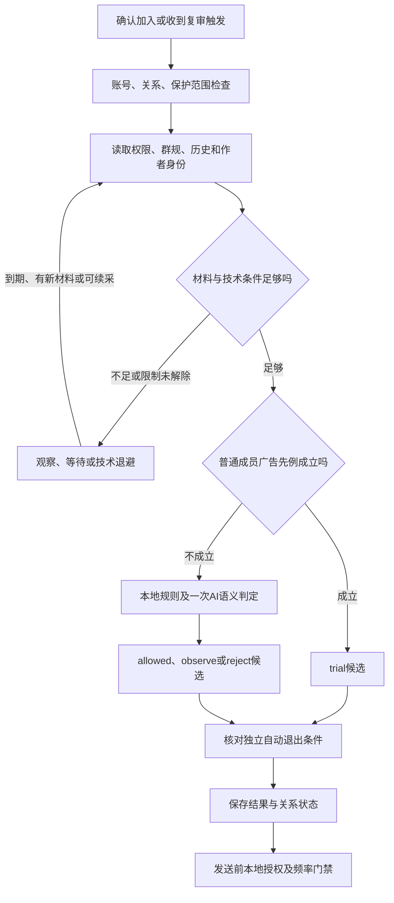

# 当前审核机制完整梳理

核查时间：2026-11-03 11:53，北京时间。目标：`oracle4c24g` 的 `vanguard-backend`。本次仅核查源码、只读数据库和既有聚合遥测，没有触发加群、广告、验证动作或修改生产配置。

## 1. 核查口径与结论

当前审核的核心对象是：**某账号 × 某群 × 本次加入关系 × `text_profile` 推广范围**。它回答“这个账号现在能否在这个群发送纯文字、引导查看账号资料的推广”，同时检查是否应退出该群。

“审核次数”混有首审、材料采集续片、观察复查、事件复验和授权维护。“读取额度”按 Telegram RPC 请求消耗；一次工作片可能读取多条消息、发起多次请求，也可能完全复用本地材料。三者不能互相等同。

本次对运行容器的10个关键文件计算了规范化SHA-256，与前序保留生产源码及11月3日发布覆盖文件全部一致。生产主应用仍是旧主流程加定向热修，不能把本地尚未完整发布的检查点、不可变快照等实现描述成已全面生效。

有效政策：审核启用、执行审核启用、执行退出启用、资格验证动作开关启用；推广和验证账号按当前启用推广账号动态计算，为 **2、33、34、35**。数据库中旧静态名单不是最终生效范围。机器人验证仍需其专门设置和每次动作准入均通过，不能仅凭总开关认定每种动作都启用。

## 2. 为什么会有这么多审核

### 2.1 实际数量

复用11:35–11:38采样的最近24小时工作成本，每种工作最多保留200片；窗口内审核样本均少于200。下表是工作片，不是完成审核数。

| 账号 | 审核片 / 涉及的账号与群关系 | 审核读取 | 续授权片 / 读取 | 同一关系最多审核片 / 续授权片 |
| --- | --- | ---: | --- | --- |
| 2 | 10 / 10 | 218 | 3 / 15 | 1 / 1 |
| 33 | 65 / 15 | 1153 | 74 / 770 | 18 / 15 |
| 34 | 98 / 27 | 1675 | 125 / 901 | 9 / 17 |
| 35 | 60 / 11 | 1237 | 107 / 972 | 22 / 39 |

35号60个审核片中49片为观察，使用988次读取，占79.9%；107个续授权片中103片返回trial，4片为rules_unknown。因此大量工作是在收集足够证据或重新确认既有授权，不是新增审核了107个群。

### 2.2 已确认的放大机制

1. **一个关系可以分多片完成。** 需要查历史、置顶、发言权限和广告作者身份，身份或读取预算到片上限后保存进度，下次续做。
2. **观察状态会等待材料成熟后复查。** 普通成员广告需要保留满24小时；权限、规则覆盖或身份不明也会留下观察任务。
3. **监听事件候选较宽。** 被关注证据的编辑、置顶、疑似群规/警告等会形成rules事件。初始入口并不要求先证明作者是管理员；“禁止、允许、广告、推广、删除、禁言”等可能进入候选，后续再确认实际意义。
4. **频道更新可能形成gap。** `UpdateChannel` / `UpdateChannelTooLong` 等线索会要求修复连续性，已授权目标也可能进入续授权。
5. **续片仍有重复前置采集。** 恢复游标前会重新取得部分实体、本人、full-info、权限、置顶和各日首批历史；跨片身份结果也不能全部复用。
6. **续授权进度复用只有5分钟。** 还绑定整个事件版本；超时、来了新事件、资料或政策变化，会使原进度不可复用。
7. **技术恢复和旧记录重排。** 预算、连接、账号租约、AI请求前配置问题等会留下重试；11月3日旧AI预检错误修复又重新排队了一部分旧审核。

身份核验成本占比已由数据证实：33/34/35的`GetParticipant`分别占审核读取29.2%/42.6%/37.1%。这一比例本身不能证明重复查询了相同对象的相同事实；同关系多片及续片前置流程提示重复读取，仍需逐片归因。聚合遥测没有保留每个工作片的完整触发来源，不能断言35号39次续授权全部来自某一种事件，也不能把所有重复片都算为浪费。

## 3. 几类审核分别负责什么

| 环节 | 检查 | 是否直接授权广告 |
| --- | --- | --- |
| 候选预览 | 群身份、可加入性、公开简介、已知人数/在线数；不读取完整历史 | 否 |
| 加入结果确认 | 已加入、申请等待管理员批准、加入失败 | 否 |
| 资格首审/完整复审 | 当前账号的权限、规则、广告先例、身份和退出事实 | allowed/trial可进入发送准入 |
| 入群机器人验证 | 管理员针对本账号的按钮、简单题或明确验证机器人步骤 | 否，动作后重新核验 |
| 已有授权的事件复验 | 规则/权限/证据变化后，原授权是否还成立 | 无变化保留；有变化转复审 |
| 广告发送门禁 | 本地授权、事件、资料、内容范围、频率、账号风险、前次回执 | 全部满足才发送 |
| 回执/存活对账 | 某条广告是否真正发送、仍存在、结果是否未知 | 不能直接替代群资格首审 |

候选预览会排除已知人数小于50、明确禁广告且已知在线小于2、身份错误或不可加入的目标。未知数值不能当作0。候选预览通过不代表取得满24小时广告先例。

## 4. 一次完整资格审核的采集与判定

### 4.1 范围和技术条件

- 自有群、人工保护群以及本账号为管理员/群主的关系排除推广及自动退出。
- 检查账号是否可用、是否确实在群、能否发文字、临时禁言、慢速模式、新人限制及收费消息。
- 账号受限但政策允许只读取证时，可以收集材料，仍不能据此推广或自动退出。
- 不同账号权限独立；同账号退出后重新加入也有新的关系时期。

### 4.2 实际读取的材料

- 群实体、full-info、简介、已核实人数及真实在线数、本人身份和当前权限。
- 置顶、管理员规则、疑似规则和管理警告。
- 最近72小时，按三个24小时分段采样，首轮各段至多100条，必要时继续，总上限1000条；置顶最多200条、广告证据最多100条。这些是采样上限，不代表每次读满或所有历史都完整。
- 广告原帖是否仍可访问、最后编辑时间、警告回复、推广目标和重复文案关联。
- 作者为普通成员、管理员、机器人、系统账号还是未知身份；管理员及系统账号的广告不能证明普通成员也可发。
- 生产主审核按片实例化身份查询额度12、规则优先8；采集器通用上限60和40不等于每片实际配置。
- 最近本账号投放记录、已知删除/限制及系统账号身份覆盖。

人数和活跃度不在第一道`quality_decision`中直接淘汰；人数及在线数会用于候选预览和后续独立自动退出判断。

### 4.3 两条授权路径

**普通成员广告先例 → trial：**根话题中至少一个已确认普通、非系统成员的广告，内容从发布或最后编辑起保留满24小时，原帖可访问、警告检查完整且未发现警告，构成试投依据。未知身份、管理员/机器人广告、仅有话题广告或已删广告不等价。

**规则明确允许 → allowed：**没有上述先例时，本地规则先识别允许/禁止/审批等，再由AI理解否定句、引用旧规、例外、付费或审批、外链与资料引流范围等。AI要求至少95分，引用支持和反对证据并解释冲突。资格主流程强制关闭二次AI复核，即使存储的通用广告设置仍写着二次复核启用。

**现有规则不一致：**普通成员先例分支会跳过AI，并明确允许覆盖一般群规中的禁广告；AI提示则要求适用的禁令优先。其他权限、系统身份、内容范围、退出和发送门禁仍生效。不能将现状描述成“任何禁广告群规都会阻止推广”，也不能将这个产品策略当作群管理员的真实许可。

AI以账号、群、资料指纹、内容范围及实质材料生成持久键，同一材料只尝试一次语义识别并复用结果。单纯时间变老、权限刷新或模型配置变化不单独产生新识别；新材料才允许新的尝试。请求前配置/地址/容量失败与真正发出请求后的失败分开处理。外发材料中的号码、账号、地址和姓名等会匿名化。

此外，已有合法资格且本账号历史广告有成功回执、真实存活满24小时证据时，可以走连续授权恢复为事件型trial；一条旧success日志本身不足以放行。

## 5. 结果、执行状态与后续动作

| decision | 业务含义 | 后续 |
| --- | --- | --- |
| allowed | 明确推广允许依据成立 | 关系approved、广告active，仍检查发送门禁 |
| trial | 已核实普通成员先例或符合自身存活恢复条件 | 可试投，仍受全部发送门禁和频率控制 |
| observe | 身份/群规/内容范围等证据不足 | 不授予新广告权限；等材料、期限或事件 |
| wait | 临时禁言/慢速等已知期限 | 等到允许的复查时间 |
| technical_wait | 预算、连接、租约、读取失败等 | 记录实际恢复期限；不等于群质量差 |
| reject | 本次不授予推广资格 | 不等于立即退群，需另有已确认退出事实 |
| protected | 自有、人工保护、管理身份等 | 排除推广及自动退出 |

`queued / running / reviewing_ai / waiting_ai / completed / waiting_membership`等是任务执行状态，与上述decision分开。`completed`只表示本片结束，既可以通过，也可以拒绝、观察或等待下一次工作。界面把`waiting_ai`显示成“审核未通过”容易混淆，它不等价于群已被判定不合格。

已有授权的一次技术失败不自动抹掉旧授权，但未核验的待处理事件等仍可挡住发送。

## 6. 哪些事情会触发审核，多久再审

| 触发/状态 | 当前安排 |
| --- | --- |
| 确认加入 | 建立本次关系的首审；待管理员批准则waiting_membership |
| 当前关系缺审、策略版本变化 | 自动补建，稳定批次键去重 |
| 管理员手动批次重审 | 按批次幂等，新批次可以建立新工作 |
| membership / rules / gap事件 | 合并待处理事件；已有授权优先做对应范围的续授权 |
| 系统账号身份清单变化 | 复用可确认的身份清单或要求重采集 |
| 普通观察 | 通常到观察开始后2小时，再到24小时判断，不是永久每2小时全审 |
| 已知权限限制 | 服从限制到期时间；确认禁言部分分支至多约2小时复查，新人限制可等到入群48小时 |
| 普通成员广告未满24小时 | 预约到实际成熟时刻复查 |
| 身份采集未完 | 通常约15分钟后续片，权限能力退避优先 |
| AI请求前预检失败 | 至少60秒，常用300秒，复用已有材料等待恢复 |
| AI结果不确定的旧兼容分支 | 同材料不确定结果调度计数首次约12小时、再次24小时、第三次终结；不等于发出3次AI请求 |
| 明确AI fail | 同材料不定期重买识别；真实材料变化或广告成熟可唤醒 |
| 读取预算/RPC等待 | 至少60秒并服从实际retry_after，恢复准入需够完整工作片 |
| FloodWait/SlowMode | 保守至少2小时，并服从平台更长等待 |
| 操作租约争用、取消等 | 各自退避；普通账号操作租约争用常见2分钟，取消60秒 |

总调度器约15秒扫描，review stage正常间隔30秒、每账号量子最多2条。这是队列派发粒度，**不是所有群每30秒重审**。旧入群2h/24h状态机仍有代码，但资格政策启用时当前主入口交给持久资格队列，不能将旧周期当作当前全群复审计划。

观察满24小时仍规则/资料不足、AI失败计数耗尽且没有成熟或续采期限的部分任务会停止无变化定时，等新证据或显式重审。普通allowed/trial授权的`renewal_at()`为None，不存在每天一次全审的统一规则；历史连续授权还有3次后14天维护的兼容分支。

## 7. 事件续授权、去重与缓存的真实边界

- 同一事件种类及source token的精确重放忽略；事件种类合并，关联消息ID上限32。不同消息或后来事件仍可以建立新待办。
- 监听入箱按事实和约5分钟桶等幂等，不能把它理解成所有语义相似文本永久合并。
- 同一关系只选择当前策略/加入时期的最新非取消审核，已被替代的任务退役；账号和行租约限制重复并发执行。
- 完整收集的材料和事件操作键相同，且非强制刷新时，可以给AI复用。AI材料去重不等于Telegram采集永久去重。
- membership事件通常检查本人身份/权限；rules/gap还可能读取简介、置顶、指定消息、管理员规则、警告及trial原始先例。
- 续授权未发现变化时保留原授权；真正变化时转observe/完整复审；网络读取失败不能制造禁止事实。
- 续授权没有待处理事件且原授权合格时，可以只完成本地检查，不产生Telegram读取。

证据TTL为720小时（30天）。显式事件模式授权不因单纯经过30天到期；旧非事件授权仍检查expires_at和证据年龄。不能把通用广告设置中的1天TTL描述成资格主流程每天全审。

## 8. 哪些情况会自动退群

生产`execute_exits=true`，但退出需单独事实和执行前授权，不能仅凭reject或AI故障直接退出。资格审核分支的规则为以下任一成立：

1. 最近48小时完整读取，确认没有普通成员广告，且没有隐藏历史、身份不明、原帖不可访问等相关不确定性；
2. 已核实群成员数少于50；
3. 明确全群禁广告，且真实在线数少于2，两个条件同时成立；
4. 已确认永久禁言，或符合超过3天长期发言限制的证据条件。

资格审核退出事实优先于推广允许，需来自本次约5分钟内的新鲜采集，同账号同群同次加入、非保护范围。无法读取和未知信息不能代替退出事实。

另有广告反馈退出分支：自适应频率启用时，已处于exit_pending的频率状态，可以根据同账号、同次加入后的真实广告日志及反馈事件提供退出理由。已确认禁言且未被撤销，或投放配额已降到最低1次时仍出现删除/daily_deleted等反馈，可命中此路径。该路径不是上述“新鲜完整reject审核”的要求，不能把5分钟完整采集要求套到所有退出原因上。

两类路径均保留退出开关、作用域、账号状态、保护目标及退出前的实际身份/授权检查。

## 9. 入群验证和真正发送的边界

机器人验证为独立动作流程：通常限近期48小时加入、observe/wait且仍有效的关系；只处理已核实管理员/群主针对本账号的近期提示；每轮最多1个动作、同次加入最多3个已发起或不确定动作，关闭AI解题、未知题不盲试。动作后再次排队资格核验，常规5分钟后检查。它不等于授予广告资格。

发送边界消费本地授权、权限快照和待处理事件状态，**不会每条广告都读取72小时历史或调用AI**。仍要求账号可用、当前关系approved、allowed/trial有效、资料指纹及系统身份一致、非保护群、无未处理变化、频率/冷却/暖机/配额满足，以及没有未处理的前次发送不确定结果。

当前资格范围为`text_profile`，不授权媒体或正文URL；不是任意广告素材通过一次后都可发送。自身广告成功、删除、存活和未知回执另有对账流程，其计数不能混作群首审次数。

管理员可通过`/api/automation/group-reviews`批量排队、查看列表和证据详情；该接口没有“直接强制批准”的动作。主审核也不是等待人工逐群审批的队列。

## 10. 需要改进的机制点

1. 将首审、采集续片、观察复查、事件续授权和技术等待分开显示，分别统计真实读取、AI调用和完成量。
2. 给每个工作片记录不可变触发来源、事件版本、新证据数量和有效推进量，才能精确归因22/39次重复。
3. 缩窄或分级疑似规则事件，合并同关系短时间多次变化，避免每个候选都重做大范围授权维护。
4. 续片先恢复有效进度，复用稳定材料与权限失败退避；检视5分钟进度TTL在预算长等待时造成的重做。
5. 统一“普通成员先例”和“明确群规禁止”的产品优先级，消除两条判定路径的不一致。
6. 修正waiting_ai等界面文案，并展示预算基础份额、借额后真实可用量及工作片所需量。

本次只完成机制梳理，不代表上述改进已实施。现有PG工作量账本接线不足，不能由可变审核行的attempts推算每天完整审核成本。

## 证据与主要实现

- [上一轮预算与成本评估](2026-11-03-review-budget-assessment.md)
- 生产聚合取样：`tmp/growth-repair-20261103/review-mechanism-current.txt`，含生效政策、最新关系记录的历史聚合和10文件哈希；其中历史reject不代表当前仍在群或刚发生失败。
- 原始生产主应用：`tmp/growth-repair-20261103/vanguard-backend/app/`；实际热修覆盖：`tmp/growth-repair-20261103/release/main/app/`。
- 证据和权限：`backend/app/modules/acquisition/group_qualification.py`；判定与排程：`qualification_service.py`。
- 监听触发：`backend/app/core/account/listener_interest.py`；事件合并：`qualification_events.py`。
- 续授权：`qualification_renewal.py`、`qualification_actions.py`、`renewal_progress.py`；有效期：`qualification_lifetime.py`。
- AI：`qualification_ai.py`；队列：`qualification_due.py`、`qualification_recovery.py`、`review_retention.py`。

本报告描述的是已核验生产机制。引用同名本地文件用于导航时，不代表该文件所有新增实现均已发布。
