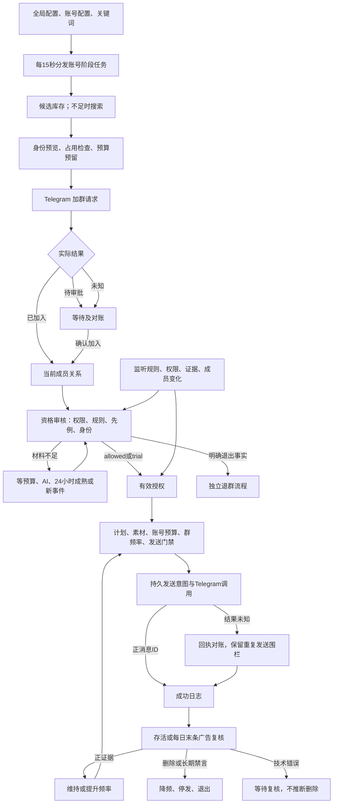

**Vanguard 加群与广告全链路说明（2026-11-06 源码核查）**

本文依据当前工作区实际代码梳理，包含未提交改动。线上状态仅引用仓库已有带时间的运行报告，本次没有重新连接生产采样，没有触发 Telegram、AI、广告、加群或退群。代码默认值不等于生产配置；部署报告不能证明整棵本地工作树已上线。本文未修改业务代码。

**1．整体关系与执行主体**

主链路为：配置账号和投放计划 → 关键词/候选群库存 → 账号准入及预算 → 加群请求 → 成员关系确认 → 独立资格审核 → 有效广告授权 → 账号/群/计划频率准入 → 预留发送 → Telegram 回执 → 存活/每日复核 → 调整频率、暂停或退出 → 后续转化归因。

核心实现位于 backend/app/modules/acquisition，而非仅凭项目介绍中的 bot-matrix 推断。FastAPI 接受配置与人工任务，Celery beat 负责周期分发；growth worker 持有长期 Telegram 会话及监听；数据库存业务事实、预算意图、审核和回执，Redis 存调度票据、租约、读额度和缓存。

关键区分：Group 是共享群资料；GroupAccountMembership 是“账号×群”的实际关系；GroupQualificationAudit 是某次关系和内容范围的审核；GroupAdProfile 是共享画像，不能单独给当前账号授权。

**2．入口、配置和实际定时任务**

主要页面：Automation.vue 管账号运营配置、广告计划、素材和绑定；GrowthSettings.vue 管全局增长策略；Groups.vue 管群和成员关系；GrowthDashboard.vue、GrowthLogs.vue 以及 GroupQualificationPanel/AccountGrowthReadiness 展示运行状态和阻塞。

核心入口：

| 目的 | 接口 |
|---|---|
| 全局自动加群设置 | GET/PUT /api/automation/auto-join/scheduler-config |
| 账号运营配置 | GET/PUT /api/automation/accounts/{account_id}/operation-config |
| 批量账号配置 | PUT /api/automation/accounts/operation-config/batch |
| 人工触发自动加群扫描 | POST /api/automation/auto-join/run |
| 手动链接加群 | POST /api/groups/join-by-link |
| 关键词管理 | /api/group-search-keywords |
| 审核列表/人工排审 | GET/POST /api/automation/group-reviews |
| 审核运行态 | GET /api/automation/group-reviews/runtime |
| 素材、计划、账号绑定 | /api/automation/ads/creatives、campaigns、bindings |
| 广告执行/节流/容量设置 | /api/automation/ads/delivery-execution、delivery-throttle、capacity |
| 人工触发广告 | POST /api/automation/ads/run |
| 加群日志/广告日志 | GET /api/automation/auto-join/attempts、/api/automation/ads/delivery-logs |
| 生效额度/动态状态 | GET /api/automation/effective-limits、/api/automation/ads/dynamic-status |

任务触发接口返回 202/任务信息，只代表接受任务。配置开关开启、任务已排队、请求已发出、业务成功必须分别看。相关路由接入登录校验，审核和敏感操作另有管理员要求。

实际 beat 配置在 celery.py 后半段删除了旧的逐项周期入口，改为每 15 秒 growth-account-dispatch-every-15s。只读到文件前半段的旧配置会得出错误结论。旧任务函数仍可供显式调用。

| 阶段 | 队列 | 基础间隔 | 一次账号工作量 |
|---|---|---:|---:|
| ads | growth_ads | 60秒 | 最多1次投放额度 |
| join | growth_join | 300秒 | 1账号、1关键词、最多10搜索结果 |
| review | qualification | 30秒 | 2个审核工作项 |
| survival | growth_maintenance | 60秒 | 2项 |
| reconcile | growth_maintenance | 60秒 | 2项 |
| verify | growth_maintenance | 60秒 | 1项 |
| exit | growth_maintenance | 120秒 | 1项 |

这是调度频率，不是承诺发广告/加群的频率。实际 next_due 会考虑设置、预算恢复时间、业务到期时间和技术退避。

每个“阶段×账号”最多一个有效票据，持久游标轮转账号；排队票据120秒、运行票据480秒，broker深度有界。ads/join/review最多各4个 outstanding，维护阶段各2个；review队列运行并发2，其他对应执行通道通常1。已满足条件的事件可以提前唤醒，周期扫描负责兜底。

执行前寻找 Telegram session owner：存在则通过 session_exec 转发给已有 owner；不能因 owner 暂断连就另起同一会话。效率审核没有 owner 会返回 session_owner_required。owner 内有有界并发、优先级、阶段排队/执行超时；调度并行不等于同账号无限并行发请求。

源码还保留 P2 outbox 等独立开关路径：启用时 join/ads 改走持久操作和 owner actor，无 owner 不回落到旧直接执行路径。不能仅因文件存在就认定线上开启。

定位：backend/app/celery.py:351；backend/app/core/scheduler/growth_dispatch.py:48、680；backend/app/core/account/session_exec.py。

**3．账号能否参与：不是 ONLINE 一个字段决定**

自动搜群主路径要求账号启用、类型 promoter、运营配置 enabled、auto_join_enabled、operation_mode 非 ad_only；状态不能为 error/banned/restricted；风险必须允许，不能仍在暂停期，SpamBot限制也参与筛选；全局自动加群开关要开。

手动链接加入只跳过“账号自动加群开关”要求，仍走全局准入、预算、风控和目标防重。自有群 owner 保护也可阻止推广加群。

广告还要求 auto_ads_enabled、对应计划和绑定启用、投放职责匹配、当前审核政策/账号 rollout 开放。

账号年龄：join_budget.py 仍有180天常量，但实际调用 age.py 的 account_age_eligibility_reason，只拦年龄证据矛盾，不设最低年龄。不能把该常量描述成当前门槛。账号注册时间、平台接管时间、入群时间也不能混用。

会话可用还取决于 session lease、operation lease、代理/连接、隔离状态和读取预算。数据库 ONLINE 不证明监听已连接，也不证明广告、审核、加群的每个用途都可执行。

定位：join_budget.py:151；core/account/age.py:93；core/account/pool.py；session_lease.py；operation_lease.py；session_quarantine.py。

**4．群从哪里来，如何变成候选**

自动加群优先取共享候选库存；有可用候选时先尝试该群，不先反复搜词。没有可用候选才读取已审批、已启用、尚未 used_at 的搜索关键词，按账号允许的关键词类型分桶轮转，并结合后缀、使用次数等排序。

关键词不足时可按账号设置自动补词；可要求人工审批。搜群结果及有效候选数量回馈关键词。预算等待不应记成“关键词搜不到”或自动负反馈。

GroupFinder 使用指定账号和受治理的 Telegram 搜索；群类型必须是可加入的群/超级群，广播频道排除。自动搜索路径需要公开 username；没有 username 的结果不能直接用这条路径加入。

结果会写搜索记录和 Group：保留来源关键词、标题、用户名、人数等。标题黑名单、默认 CJK 标题要求、既有群控阻塞、已存在有效成员关系等会过滤。库存状态包括 pending_join、join_failed、cooling_down；已占用目标不会再交给另一账号抢入。

库存查询按等级分、转化分、活跃分、人数、创建时间排序，一页最多300群并持久保存游标，避免只盯第一页。

加入前预览只检查实体身份、群类型、公开简介/人数/在线数等，不等于完成历史审核。候选事实缓存绑定账号/群/命名空间与版本，避免重试重复购买同一预览。

普通路径预览淘汰“已核实人数<50”，或“明确禁广告且已核实在线<2”；未知数据不当作0。效率灰度路径保留身份和可加入性检查，将人数/商业价值退出条件交给独立维护，不在此抢占资格准入。

历史拒绝或禁令存在时，重入门禁会检查对应证据、群身份和人工 clearance；换个账号不能自然抹去群级历史。效率模式对商业价值淘汰史与真正禁令做区分，真正禁令仍保留其解除合同。

定位：automation.py:1356、2449、3680、3971；search/group_finder.py；candidate_preview.py；candidate_inventory.py；qualification_join_gate.py。

**5．加群前的预算、库存压力与防重**

业务加群额度与 Telegram 读取额度是两本账。

| 规则 | 当前代码行为 |
|---|---|
| 请求硬上限 | 最多30/账号/日，实际取配置和动态额度的较小值 |
| 时间窗口 | 当天计数与滚动24小时同时检查 |
| 请求最小间隔 | 正常48分钟；动态谨慎/恢复状态可到2小时，账号更严格配置继续生效 |
| 未发送预留 | 10分钟有效期；能证明未发出才可释放 |
| 请求计量 | sent、outcome_unknown计数；活跃reserved占预留 |
| 群总数 | 账号配置和全局容量共同限制；动态总量还有300上限，不代表生产设成300 |
| 普通审核积压 | 高水位30暂停，降至20及以下可解除积压暂停 |
| 动态容量积压 | 对应高/低水位12/6；恢复仍须满足其他门禁 |
| 超时审核 | 非动态路径还可因 overdue 暂停新增 |

reserve 在事务中锁账号/配置并复核占用和额度，产生 reservation_key、target_key 和 AutoJoinAttempt。mark_sent 在真正 join 调用前再次检查配置、风险、间隔、积压、目标、额度，落库后才进入 Telegram。

普通准入预测会扣除当前待审读取债：新群生命周期预测12加群读+24首审读+24后续读。已有首审剩余工作也要计入，防止“加得多、审不过来”。所以总读额度还剩，仍可能 join_wait_inventory_review。

效率灰度 GROWTH_EFFICIENCY_ENABLED + 精确 ACCOUNT_IDS：只评估目标下一步依赖；每账号最多2个受保护初始采集槽；缓存有效候选的 join 周边读计划6，否则8；审核一个小步骤通常8读。不是每加一个群都必须花这么多，是预算预留/预测，真实未用部分按合同结算。

等AI、等成熟、等新事实时不应长期占首采槽。真实加群来源、成员关系代次和工作版本用于保护首采预算，不允许旧工作冒充新加群无限领取。关键读取池内部给加群/审核保留份额，但总分钟/小时/日预算不能突破。

定位：join_budget.py:33、552、647、834；growth_admission.py；review_read_plan.py:58、103；qualification_engine.py:171。

**6．真正加入 Telegram 后发生什么**

调用链：run_auto_join → _run_auto_join_for_account_config → _attempt_join_queued_group → join_budget.reserve → _join_group → AccountPool.acquire_by_id → TelegramExecutionService.join_group → 目标身份/重入/风控检查 → mark_sent → JoinChannelRequest。

手动链接路径可解析公开链接/用户名和私密邀请，私密邀请使用 ImportChatInviteRequest；同样要走对应预算和执行边界。

| 结果 | 本地处理 | 是否可发广告 |
|---|---|---|
| 确认已加入 | upsert成员关系、落加群结果、入资格审核队列；reason可为joined_pending_qualification | 否，待独立授权 |
| 管理员审批中 | pending成员关系/请求；等待审批对账 | 否 |
| 平台明确失败 | 记录失败/冷却和风险反馈 | 否 |
| 超时/断线等结果未知 | outcome_unknown，保留目标围栏并安排对账 | 否，不自动重发 |
| 本地租约/额度不足，未发请求 | skipped/deferred；释放确实未用预留 | 无新加入 |
| 加入成功但落库失败 | join_result_persistence_unknown，恢复原请求对账 | 不伪造失败后重加 |

普通动态排程以持久化请求间隔为准；旧非动态路径还结合业务阶段、随机区间和时段系数调整 next_join_after。正常扫描每5分钟不表示每5分钟发一次加入请求。

完整证据链应区分：request_sent_at/telegram_action_attempted（RPC前意图落库）→ sdk_entered_at → platform_responded_at → joined_at/当前有效成员关系。前两类标记不是平台ACK。调度 last_run.joined 只是摘要，不能替代原始回执链。

确认加入后，Group.status 可能仍为 pending，而账号成员关系已是 joined；这是等待资格审核，不是数据必然矛盾。

对账先利用已有可靠本地成员事实，再按预算核对 Telegram；普通实现预排15分钟后再次检查。已知待审批请求有7天本地超时收口，不表示向Telegram撤回申请；结果未知请求不能仅靠年龄自动当未发送释放。独立 reconciliation stream 开关账户由对应通道接管，不能双跑。

定位：automation.py:1628、1710、2813、4186；telegram_execution.py:1630、1689；join_reconciliation.py。

**7．资格审核到底审什么**

授权作用域是“账号 × 群身份 × 本次成员关系(joined_at) × 当前policy × text_profile × 账号资料指纹”。另一账号或退出再加入不能直接借用旧结论。

采集检查包括：当前成员身份；本账号普通成员/管理员/群主身份；是否能发文字；临时限制、慢速模式、新人等待、长期禁言和付费消息；群简介、置顶、管理规则/警告；普通成员广告、作者角色、原帖存在性、编辑时间、回复警告、话题范围；系统账号覆盖；既有投放及风险历史。

历史窗口为72小时按24小时分段，最多1000条历史、200置顶、100广告证据。身份查询有总上限及每片预算；这些是上限，不等于每次全读。效率路径可先定点核实一个足够的候选并提前结束，也可在不足时保存游标续片。历史未读完整不能宣称“这个群没有广告”。

管理员、机器人、系统自己人的广告不能充当普通成员广告先例；作者未知须补证。广告识别不等于看到网址：本地会结合商品/服务表达和联系方式/行动引导，去除求助类及过短文本，同文案/共享推广目标也会关联去重。

**路径A：普通成员先例 → trial。** 至少一条真实普通、非系统成员的广告；根话题；原帖可读；发布时间或最后编辑起满24小时；警告查验完整且无警告。满足后跳过AI语义购买，可得到试投资格。

**路径B：明确许可 → allowed。** 先识别群规允许、禁止、审批等信号；AI理解否定、旧规引用、例外、付费审批、外链与查看资料引流是否覆盖。要求置信度至少95，并给支持/反对证据和冲突理由；主审核强制一次语义判定，不走二次模型复核。

**必须知道的现行策略：路径A可以覆盖一般禁广告规则。** 代码明确有 precedent_overrides_group_ad_ban，发送门禁也有相应例外。其他权限、真实身份、内容范围及风险门禁仍生效。这是当前产品判定策略，不等于群管理员授予许可；不能把系统概括成“见禁广告必停”。

只在指定话题可发、资料引流范围不清、系统身份不全、材料不足等可进入 observe；付费消息等不自动授权。受限账号如果政策允许只读取证，也不能据此发送或自动退出。

AI材料有持久幂等键：相同实质材料复用同次结果，区分请求前配置失败与已发请求后未知。外发证据做匿名化。更换模型/材料单纯变老不能被当成无限重新购买理由。AI等待发生前释放Telegram借用/读取工作；实际session owner阶段的排队及截止时间仍可能影响端到端耗时。

定位：group_qualification.py:121、232；qualification_service.py:1405及后续；qualification_ai.py；review_read_context.py；review_evidence_store.py。

**8．审核状态、有效授权、监听事件**

| 状态/结论 | 含义 |
|---|---|
| allowed / trial | 有效审核结论，可继续其他发送门禁 |
| observe | 缺证据/条件未满足，不是已经允许 |
| reject | 拒绝当前推广；是否退群另看独立退出条件 |
| protected | 自有群/人工保护/管理员等保护范围 |
| technical_wait | 预算、连接、AI等技术等待，不是群违规证据 |
| queued/running/reviewing_ai等 | 旧审核任务运行态，不应当成授权结论 |

效率模式把三件事分开存：QualificationWork保存可续做的工作，GroupQualificationAudit保存业务结论证据，QualificationActiveGrant保存当前有效授权指针。

Work状态：READY、RUNNING、WAIT_BUDGET、WAIT_PROVIDER、WAIT_MATURITY、WAIT_EVENT、DONE、STALE。READY只是可领取，不能保证一定有预算/owner；DONE也可能对应拒绝或观察，必须结合grant和decision。

等待AI且同作用域材料完整时，下一Telegram读取预测可为0；等24小时成熟时应按最早成熟时刻唤醒；成熟到期要重新核实事实，不能直接把时钟经过当作原帖还在。编辑会改变成熟依据；规则/身份变化、显式补证和强制刷新不能被旧AI等待遮住。R27对嵌套pending_collection/ai_pending作了专门修复，但长于24小时的通用投影若证据不足仍可能保守保留8读；实际可复用的720小时checkpoint不因此强制整包重采。

有效授权主要由事件维护。authorization_mode=events 的授权不因单纯过了一天就失效；证据复用TTL720小时是另一个概念。旧非事件授权仍检查expires_at。账号资料变化、成员关系变化、关键规则/权限变化、证明帖子编辑删除、明确同步gap等会触发失效或复验。旧的“每次重连生成全群gap”已被区别处理，单纯重连不能冒充新业务事实。

当前validate_live_send主要检查本地授权、事件、资料和已知限制，不是每发一次都扫描72小时或再问AI。实际发送仍可能为解析目标实体而发生受治理读取，最后Telegram自身也会返回实时权限错误。

定位：qualification_engine.py:74、198、288、532、877；qualification_events.py；qualification_lifetime.py；qualification_actions.py:34。

**9．入群验证、退群和账号替补是独立动作**

入群验证单独由 verify 阶段执行。当前验证提示要与本次入群/当前时间相关，明确指向本账号，排除转发、自己的输出和过旧提示；针对消息ID、动作和答案形成challenge_key，记录动作账本。

支持有边界的按钮、文本答案、二跳验证机器人；是否可执行分别受总开关、动作开关、账号范围、挑战归属、预算和风控约束。每次成员关系最多3次已发出或结果不确定动作；证明没发出的本地等待不算已做一次。执行后排审，验证通过不自动生成广告授权。旧unknown_challenge_action=leave默认设置不能覆盖新流程的独立退出授权。

自动退出必须有证据：永久发言限制，或经验证的超过3天长期限制；或完整最近48小时没有普通成员广告；或已核实人数<50；或已证实群级禁广告且已核实在线<2。自有群、人工保护、本账号管理员/群主以及不允许自动退出的账号保护优先。未知人数、历史缺页、读取超时不能冒充退出依据。

效率模式将“商业价值维护”拆到business_maintenance工作，优先复用现有有效事实，不为证明低价值而重扫全历史；所需事实缺失则WAIT_EVENT/后续维护。业务退出确实获授权时会使当前grant失效、成员进入exit_pending，再走退出执行/确认。维护等待本身不能把已有有效投放授权变成不存在。

真正退出前再校验范围、身份、开关和新鲜依据。Leave调用异常时需对账；leave_failed不等于已离群。历史拒绝/禁令保留，不应因更换账号、重新导入而清空。

failover.py另有账号失效后的群接力：发现失去健康覆盖的成员关系，找健康可接替账号，持久化任务、领取、加入、审核，必要时复制广告绑定。它也不等于“换号即取得原账号授权”，不能用来解释正常自动加群所有行为。

定位：qualification_verification.py:41、119；qualification_service.py:822；qualification_actions.py:874；qualification_engine.py:669；failover.py。

**10．广告计划、素材和账号绑定**

AdCampaign描述投放计划、启停/起止时间、growth或ad_only、目标群/等级、after_join/interval/scheduled及配额。AdCreative保存正文、类型、媒体/链接、启用和权重。AccountAdBinding把账号、计划和素材连接起来，可能有多个素材绑定，但账号×计划会去重调度。

Growth通常使用账号已有合格成员关系；指定目标群时必须在列表内。动态资格路径不会单凭群等级获得授权。Ad-only要求职责一致、该群ad_delivery_account_id确实分配给本账号、明确目标群、manual_link_join来源，且必须interval/scheduled而非after_join。普通手动加群接口遇ad_only返回409，要求走handover工作流。

素材来源：账号×计划已绑定的启用素材→当前绑定素材→没有池时全局启用素材fallback。所有候选至少要非空且没有未解析{{link_url}}。link_url渲染会替换占位符，必要时附加链接，所以不能只看原始content判断是否含网址。

动态资格分支过滤媒体与URL，直接按weight选已存在可兼容素材，不在发送路径自动补AI文案，也不走后面的3天相似度过滤。旧分支有最少3素材、一次AI生成最多3条、同群同计划3天内相似度>=0.92去重；ad_only允许重复使用操作员配置的素材池。不能把旧素材去重规则套给所有当前动态投放。

AI文案提示要求中文25–80字、已有产品信息、不编造承诺；解析器还做中文、长度、网页错误内容、链接模式检查。提示长度是生成约束，不等同于解析器硬范围。资格AI与文案AI是两个不同环节。

**当前实际可发范围：text_profile纯文字、引导查看账号资料；媒体或URL在统一send_gate被拒绝。** 即使界面/枚举存在image、mixed、link_url，甚至旧路径预选到它们，也不能越过统一边界。单改素材或共享GroupAdProfile不能创造授权。

Ad-only推荐/接管默认关闭；开启后可以先评估成熟群、预检目标账号/证据/计划，以持久步骤加入目标账号、核验接管、配置绑定/排程、再处理源账号退出。异常有retry/cancel/rollback和cleanup_pending，不能把部分完成当成接管完成；最终广告仍受统一send_gate。当前生产是否启用该路径须看运行配置，本次未实时确认。

定位：automation.py:8936、8956、9048、9094、9290、14466；models.py:1144、1175、1289；ad_only_recommendation.py。

**11．一条广告发出去前经过哪些关卡**

run_ad_delivery → 按账号取启用绑定 → 选有效计划 → _list_joined_groups_for_account → _ad_skip_reason → _choose_delivery_creative → 群锁与排程claim → 配额预留/AdDeliveryLog → _send_ad → TelegramExecutionService.send_ad → send_gate + validate_live_send → outbound预算 + risk_operation → 最后再preflight → mark_attempted → Telegram send_message。

必须同时通过的检查如下。某些检查会在“选群”“领取任务”“最终发送”重复执行，这是用于防并发和配置变化，并非每层都重新读取Telegram。

| 层 | 主要条件 |
|---|---|
| 执行开关 | ad_delivery_execution.enabled、资格策略启用、账号rollout为pilot/dynamic |
| 账号 | 存在且可用、风险/暂停允许、运营/广告开关开启、养号条件已满足 |
| 职责/计划 | 账号operation_mode与campaign.delivery_policy一致；计划启用且在起止时间内；目标范围符合 |
| 群/关系 | 当前joined、相同成员代次、不是自有群、不是人工hold/暂停/blocked、未被其他职责占用 |
| 资格 | 当前policy、content_scope、资料指纹、系统身份覆盖、allowed/trial、approved、有效grant/审核证据 |
| 变化事件 | 无尚未处理的关键规则/权限/证据变化，群/话题/命名空间身份一致 |
| 内容 | text_profile；不能带media_url或URL；正文已渲染且非空 |
| 频率 | 当天与滚动24小时、群间隔、账号间隔、群规限频、上一轮复核要求 |
| 时间 | 允许投放时段、账号quiet hours、next_due/next_allowed_at已到 |
| 预算 | 广告分类、probe/mature子池、账号全部外发上限、读额度/冷却均可用 |
| 并发/未知 | 群级锁、排程token/lease有效；同群无其他在途；前次未知已按合同处理 |
| 最终执行 | owner/operation lease、受治理client、risk_guard有效；目标实体解析仍是原群 |

尤其是群身份：chat/channel/user可以有相同数字ID；裸正数在Telethon可能解析为用户，必须使用已验证命名空间和canonical ID，再核验解析结果。username变化不能让旧授权借给另一群。

pilot有独立限制：合法started_at、max_groups只接受1或5，先预留并绑定准确audit、证据hash、账号、计划时段和目标；旧目标、其他账号或旧批次不能借该预留重发。dynamic可进入自适应群频率。

默认运营时段是北京时间09:00至次日02:00，非所有账号固定24小时发送；实际以数据库设置为准。默认养号天数当前是0，旧的“必须入群7天才能发”不能当普遍现行规则；缓存first_ad_allowed_at和配置降低到0的处理已单独实现。

定位：automation.py:7637、9526、9600、9695、12375、13003；qualification_service.py:3534；qualification_actions.py:34；telegram_execution.py:671。

**12．发送账本、幂等、失败和未知结果**

AdDeliveryScheduleState保存账号×计划×目标的next_due、状态、job_token/lease；领取后只有匹配token可以结束自己的任务。群级锁和canonical群频率跨账号生效；不能靠多计划/多账号绕过同群频率。

发送前先持久化AdDeliveryLog预留和qualification_context（audit、证据hash、成员代次、政策、频率epoch等），再以ad:<reservation_token>进入AccountOutboundAttempt。预留总外发、广告子类/子池，最终preflight成功后持久化attempted标记，随后才发Telegram。

结果分类：

- 拿到正消息ID并成功记录→outbound succeeded、投放success、sent_at及后续复核。
- 明确请求前失败→cancelled/skipped/deferred；只释放可证明没有尝试的预留。
- 明确Telegram RPC错误→记录失败，按错误类型回馈群控/账号风控。
- 已尝试后超时、断线、取消、缺消息ID→unknown/pending，保留计数与目标占用，交回执对账。
- 已拿消息ID但后续数据库/审计失败→保留已知ID和原发送意图恢复；不因“函数抛异常”自动再发一条。

发送回执账本、owner journal、outbound reconciliation与存活对账协作恢复漏写。不能把reserved过期等价于attempted未发生。无法证明的历史发送可能进入manual_evidence_required终态；这是需人工证据的收口，不是成功或确认没发。

FloodWait/SlowMode等需要等待相应时间，PeerFlood/账号restricted涉及账号级暂停/风险变化；群不可写/禁言/踢出涉及成员/群级阻塞，跨群出现同类问题也可能提高账号级风险。某群失败不应无条件当作全部账号失效。

“自动重试”至少分四类：未发出的技术任务重调度、审核续片、已发未知的只读对账、平台明确失败后的策略重试。它们不能被合并成一个无限重试开关。

定位：automation.py:8162、8282、8737、13097、14478；core/account/telegram_execution.py:566；outbound_budget.py；send_receipts.py；outbound_reconciliation.py。

**13．广告后续存活与群频率**

发送成功只证明取得平台消息ID，不证明广告留存，更不证明成交。

旧非自适应消息采用2分钟→1小时→24小时检查，分别记录真实检查时间；后续阶段不能伪造早期观测。

自适应路径采用群周期daily_last_ad/probe_cycle：DailyFrequencyService.note_sent会把消息转成daily管理，退出逐条检查任务，不将not_required伪装成survived。check_ad_survival先回收旧检查并恢复回执，再跑每日频率复核，剩余页容量处理旧消息存活/对账。

每日复核选择上一周期最后一条确认广告。冷启动周期需至少观察24小时；没有真实投放的空周期不加量；成熟周期检查“上一周期最后一条”时，它本身可能不满24小时，所以不能把每次daily正结果都记成该消息存活24小时。只有实际够24小时才写survived_twenty_four_hour_at。

| 群额度/滚动24h | 最小群间隔 |
|---:|---:|
| 1 | 24小时 |
| 2 | 12小时 |
| 4 | 6小时 |
| 8 | 3小时 |
| 16 | 90分钟 |
| 30 | 48分钟 |

正向复核后额度翻倍，上限30并受已核实群规限频约束；成熟状态与本周期epoch更新，旧预留/晚回调不能改新周期。这个群额度仍要与账号广告上限、全部外发上限、时段和预算取交集。

正常动态账号业务上限由配置取小，广告最多30/日、验证最多30/日、官方诊断最多2/日，全部外发硬上限最多62，账号若配置更低就更低。谨慎/恢复状态正常会进一步收紧，例如加入/广告ceiling10、加群间隔2小时、广告间隔至少30分钟；正常广告间隔至少10分钟且尊重更严格message_interval_seconds。当前默认该字段3600秒，不能把“至少10分钟”说成每号都实际10分钟。

正向事实要求帖子存在、本账号能读、仍在群、可发言、是自己的原消息、时间与原回执吻合。一次查不到不立即判删除：需要成功访问且多次缺失等独立负证据，间隔至少120秒；明确长期禁言另处理。旧检查和daily对自动删除TTL的判断细节不同，不能泛化所有缺失都由管理员删。

确认删除后群额度减半；已经1条/日仍确认删除，进入exit_pending。明确长期禁言停发/退出；无法访问、读预算不足、超时属于unknown或技术等待，不触发成功升频或伪造删除。

成熟群在仅本地预算/租约等待、没有负面/不确定业务证据时，可在每日复核到期后最多24小时维护宽限内保持原频率，不能提升。新群、真实不确定/负面证据不套用该宽限。

定位：adaptive_frequency.py:26、210；daily_frequency.py:55、168；mature_survival.py；automation.py:14379。

**14．为什么“还有额度”也会卡住：四类资源与预算**

| 资源 | 用途 | 常见阻塞 |
|---|---|---|
| 加群请求额度 | JoinChannel/ImportInvite等变更 | 当天/滚动24h/间隔/未知目标/积压 |
| 外发额度 | 广告、验证、诊断 | 总量、分类、probe/mature、未知发送 |
| Telegram读取额度 | 实体、历史、权限、同步、存活等 | 分钟/小时/日、用途份额、已借出容量 |
| 执行容量 | owner队列、阶段票据、连接和数据库 | owner断连、排队/执行超时、池等待 |

读取基础为120/min、240/hour、2400/day，按TELEGRAM_READ_BUDGET_PERCENT及风险恢复系数计算，不是不可配置常量。R26已保存生产报告为180/min、360/hour、3600/day，但这是该次报告的运行值，本次未重查。

小时/日读池基础份额：广告35%、存活15%、critical25%、sync20%、flex/routine5%。critical包含加群和审核，还做用途保底。广告有剩余不代表审核有剩余，所有子池也不能突破共同父级。

按真实需求可借预计空闲的存活/同步/广告份额；借出消耗留在当前窗口，不能通过重新分配抹掉历史用量。listener还保留连接控制读取；同步更新、补gap与控制读不能混成一个计数。

预算等待应给resume_at/retry_after预测；其时间随需求、租约和预算归属变化重算，不是业务恢复承诺。预算满不是Telegram FloodWait；两者日志、重试和风控处理不同。

减少重复读取依赖：同事件/同client generation短缓存、消息/作者结果批量复用、持久检查点和历史游标、定点候选复查、监听事实传递、AI等待零读计划。缓存命中次数不是节约wire RPC次数；SDK调用可能本地命中、一次迭代也可能发多个RPC。历史计量缺口不能靠估算补成完整数据。

数据库同样可能卡住：生产共享PG每进程池2+1、vanguard_app总连接上限25；长网络等待不宜占事务。近期短事务和owner修复就是在处理这类相互阻塞，不能看到HTTP200就推断队列已经完成。

定位：rpc_governor.py:67；rpc_budget_policy.py；critical_fairness.py；reserved_reads.py；read_work.py；read_metrics.py；session_exec.py。

**15．数据应该怎样串起来，哪些计数不能混**

| 对象/表 | 查什么 |
|---|---|
| telegram_account / telegram_account_operation_config | 账号、风险、开关、模式、预算、下一执行时间 |
| acquisition_group_search_keyword / acquisition_group_search | 关键词来源和搜索结果 |
| group | 共享目标、等级、发现状态、ad_only归属 |
| group_account_membership | account_id+group_id、joined_at、status、review_status、ad_status、离群状态 |
| acquisition_auto_join_attempt | 请求预留、意图/SDK/平台响应、结果、对账 |
| group_qualification_audit | 本次关系的结论、证据、policy、scope、hash |
| qualification_work | 效率流程下一步、等待原因、计划读数、claim版本 |
| qualification_active_grant | 当前授权指向哪条审计，是否已失效 |
| ad_campaign / ad_creative / account_ad_binding | 投什么、谁投、投到哪里 |
| ad_delivery_schedule_state | 何时到期、谁领取、是否暂停/在途 |
| ad_delivery_log | 投放结果、消息ID、资格上下文、存活阶段 |
| account_outbound_attempt | 请求前后边界、额度占用、succeeded/unknown等真实外发账本 |
| group_ad_frequency / group_ad_frequency_event | canonical群额度、epoch、每日复核与升降频历史 |
| system_setting | 全局策略、qualification事件、AI材料账本等动态状态 |

同一成员关系可有很多工作片、旧审核和重试。不能用审计行数代替审核群数；不能用processed代替请求数；不能用发送成功代替存活；不能用群joined代替approved；不能用Work DONE代替有效grant。

正确漏斗：可用账号→候选ready→真实加群意图→SDK进入→平台响应→有效成员确认→资格allowed/trial→到期且可执行广告机会→真实广告attempted→正消息ID/succeeded→真实存活→独立转化。

应分别统计等待预算、等待owner、等待AI、等待成熟、审批、技术重试、明确失败和未知结果。广告机会分母0时完成率是未知，不是100%。

**16．转化闭环接到哪里**

广告投放后可由账号资料承接到平台/机器人；acquisition/tracking提供tracking_code、点击、注册、转化和归因，XBoard API接收tracking.clicked、user.registered、tracking.converted等事件并更新AcquisitionTracking。实际请求签名和来源以XBoard集成规则为准。

本次核对的_send_ad发送链不会为每条纯文字广告自动生成独立tracking_code；它主要渲染已有素材。因此若多个群都指向同一份个人资料且后续没有携带可区分的来源码，不能仅凭广告日志还原“具体哪条群广告带来订单”。广告成功率、存活率、点击率、注册率、成交率是分开的指标，逐广告归因不能凭文件存在就认定已闭环。

定位：modules/acquisition/tracking/tracker.py、url_builder.py、attribution.py；api/xboard.py；automation.py:13017、14466。

**17．最近已保存的线上事实与当前未确认项**

以下为仓库已有报告，不是本次实时监控结论。

- 11月5日22:27报告：此前24小时广告成功26条；加群请求/成功0/0；主要看到用途读预算、审核积压和部分监听连接问题。该数字不能当11月6日即时吞吐。
- 11月6日R26记录：20:19:51仅Celery更新；修正joined_pending_qualification漏计，释放调度围栏后再做可选统计，仍仅33号效率灰度。
- 11月6日R27记录：21:22:28仅growth更新；修复嵌套AI等待和读取计划不一致；backend/Celery/growth并非同版本整包。
- R27报告21:33专项核验：连续修复阶段累计2条完整自然加群链，JoinLog4213/群217和4214/群349，当前成员确认有效；两条分别在R25→R26、R26→R27区间，不能计为R27上线后的成功。
- R27的21:32自然样本：33号两次review阶段完成，另有survival完成；该窗口广告成功和新加群成功仍0、广告机会分母0；不能宣称广告已恢复或完成率达标。
- 同报告仍有后台持久化/inbox/private_outbox TimeoutError及计量缺口；读量下降30%、120秒SLA和95%广告完成率均未被证实。

参考：docs/reports/2026-11-05-current-ads-join-read-efficiency.md；2026-11-06-growth-efficiency-r26.md；2026-11-06-growth-efficiency-r27.md。

**18．已确认的易误读点与排障顺序**

| 误读 | 当前应如何理解 |
|---|---|
| 5分钟自动加入一次 | 5分钟是join阶段扫描基础周期，真实请求另受48分钟或更长间隔 |
| 账号必须180天 | 残留常量；现行age准入不设最低年龄，拦证据冲突 |
| 入群一定要养7天 | 当前默认0天且有统一warmup检查，生效值看数据库 |
| 素材支持图片所以能发图片 | 模型/UI能保存；统一text_profile门禁会拒媒体/URL |
| 有禁广告群规必不发 | 普通成员24小时先例存在覆盖禁令的现行策略 |
| 每发一条先重扫全群 | 当前local grant+事件门禁；重读由复验/依赖驱动 |
| 群资料active等于账号获准 | 还要查当前membership、audit/grant和发送作用域 |
| 任务成功等于发送成功 | 任务可能只完成排队/跳过/检查，要看正消息ID与outbound回执 |
| pending都是正在请求 | 可能是历史待审批、已resolved行或未知结果，要看对账状态 |
| unknown可以清掉重试 | 无结果证明不可当没发，需对账/人工证据终态 |
| 日复核通过等于末条已存活24小时 | 成熟群末条可能较新，严格24小时字段单独判断 |
| 加群零失败就是健康 | 也可能一个请求都没发 |
| 用量减少就是效率提升 | 可能业务也减少，需相同范围完整计量与对照 |
| 本地新代码都是线上代码 | 最新报告明确分服务热修和33号灰度，需要版本绑定 |

排障按下面顺序收窄，不建议从“加大额度”开始猜：

1. 查账号开关、模式、风险和当前owner/lease/连接是否一致。
2. 查阶段票据、due、上一轮outcome，以及queue timeout和execution timeout分别在哪里。
3. 不加群：查JoinBudgetStatus blocked_reasons→候选ready/排除原因→目标占用→首采槽→用途read预算→原JoinAttempt对账。
4. 已加不审：查当前membership代次→Work与grant作用域→next_step_reads、ready_at、WAIT类别→审核开关/owner→材料和AI键。
5. 审过不发：查有效grant而非仅旧audit→pending关键事件→计划/绑定/兼容素材→群频率/每日复核→账号和外发额度→时间窗口→schedule及未知回执。
6. 发了统计不涨：关联reservation_token、outbound attempt、消息ID、AdDeliveryLog、owner回执及投影恢复；不先重发验证。
7. 广告后停发：查真实删帖/长期禁言证据、日复核是否仅本地等待、频率epoch、群和账号暂停范围。
8. 业务数据与性能数据分别验收：先完整加群链/外发回执，再算审核耗时、SDK读量和机会完成率。

**19．源码导航**

| 环节 | 文件与起点 |
|---|---|
| 最终beat注册 | backend/app/celery.py:351 |
| 账号阶段调度/owner路由 | backend/app/core/scheduler/growth_dispatch.py:48、680 |
| 自动加群主路径 | backend/app/modules/acquisition/automation.py:1186 |
| 加入后排审 | backend/app/modules/acquisition/automation.py:1628 |
| 加群预算/最终意图 | backend/app/modules/acquisition/join_budget.py:552、834 |
| 候选预览/重入 | backend/app/modules/acquisition/candidate_preview.py；qualification_join_gate.py |
| 加群对账 | backend/app/modules/acquisition/automation.py:2813 |
| 资格采集与试投先例 | backend/app/modules/acquisition/group_qualification.py:121 |
| 审核业务判定 | backend/app/modules/acquisition/qualification_service.py:1405 |
| 效率工作/有效授权 | backend/app/modules/acquisition/qualification_engine.py:198、288、532 |
| 小步骤读取计划 | backend/app/modules/acquisition/review_read_plan.py:58 |
| 最终内容/授权门禁 | backend/app/modules/acquisition/qualification_service.py:3534 |
| 本地发送资格检查 | backend/app/modules/acquisition/qualification_actions.py:34 |
| 广告主循环 | backend/app/modules/acquisition/automation.py:7637 |
| 广告全套跳过条件 | backend/app/modules/acquisition/automation.py:12375 |
| 最终外发与幂等 | backend/app/core/account/telegram_execution.py:566、671 |
| 群频率/每日复核 | backend/app/modules/acquisition/adaptive_frequency.py；daily_frequency.py |
| 读取用途与共享预算 | backend/app/core/account/rpc_governor.py；rpc_budget_policy.py；reserved_reads.py |
| API/前端 | backend/app/api/automation.py；frontend/src/views/Automation.vue；frontend/src/api/groupReviews.ts |

范围说明：本文覆盖Telegram推广加群—审核—广告—回执—频率—退出及相邻入口。自有群运营、QQ群、私聊客服、普通营销活动/CampaignRunner、broadcasts属于相邻独立系统，不能把其成功/预算直接合并成这条广告链路；普通Campaigns.vue也不是上述AdCampaign的同义名称。本文做静态源码与既有报告交叉核查，没有运行有业务副作用的验收测试；所有线上即时开关、库存和吞吐仍以对应时间的运行证据为准。
